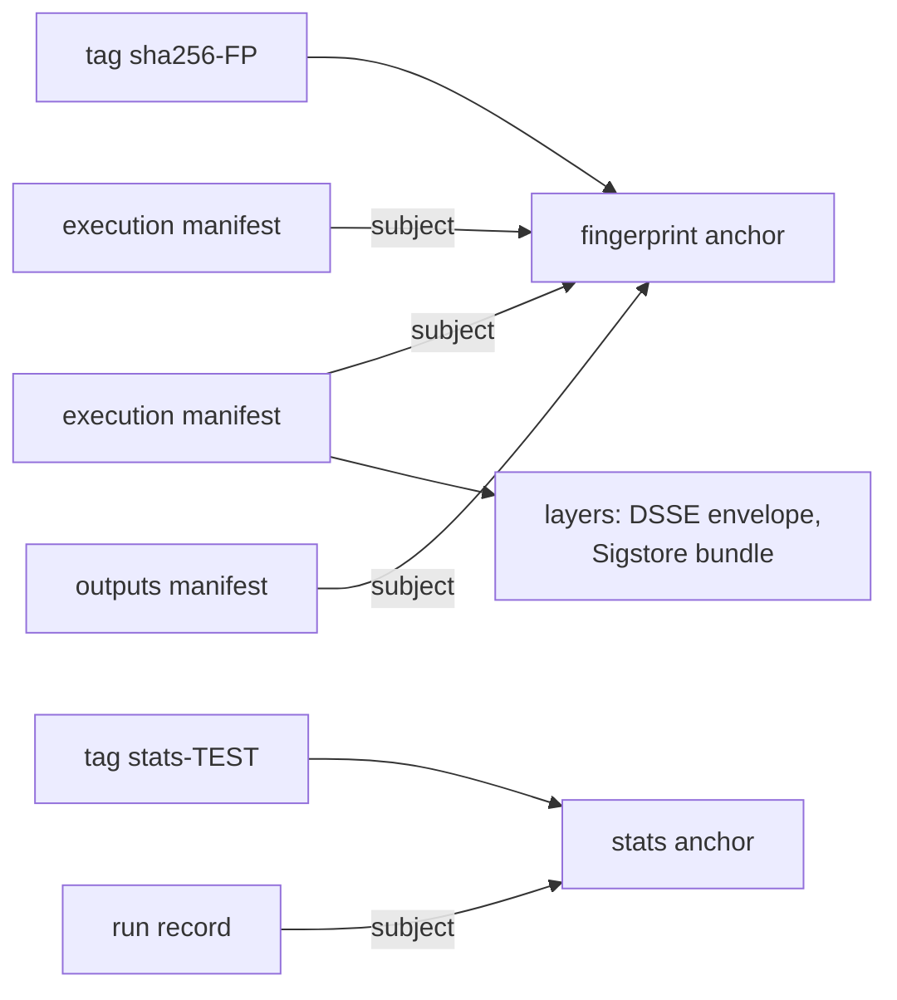

# Artifact format

How Aval stores a result in an OCI registry, what it signs, and the JSON
`aval verify -o json` prints. The Go types in `pkg/evidence` are the source of
truth. The identifiers and JSON shapes below are frozen; see
[Versioning](#versioning-and-compatibility).

## Identifiers

All constants live in `pkg/evidence`.

| Constant | Value | Used for | Status |
|---|---|---|---|
| `ArtifactType` | `application/vnd.trianalab.aval.execution.v2` | `artifactType` of the OCI manifest | frozen |
| `ArtifactTypeFingerprint` | `application/vnd.trianalab.aval.fingerprint.v1` | `artifactType` of the per-fingerprint anchor manifest | frozen |
| `MediaTypeDSSE` | `application/vnd.dsse.envelope.v1+json` | Media type of the signed DSSE envelope layer | DSSE standard |
| `MediaTypeExecution` | `application/vnd.trianalab.aval.execution.v2+json` | Media type of the raw predicate JSON, when carried on its own | frozen |
| `PayloadType` | `application/vnd.in-toto+json` | DSSE `payloadType` | in-toto standard |
| `StatementType` | `https://in-toto.io/Statement/v1` | in-toto Statement `_type` | in-toto standard |
| `PredicateType` | `https://aval.trianalab.io/attestation/execution/v2` | in-toto `predicateType` | frozen |
| `SchemaVersion` | `v2` | Predicate `schemaVersion` | frozen |
| `ArtifactTypeOutputs` | `application/vnd.trianalab.aval.outputs.v1` | `artifactType` of the manifest that carries the output files of one execution | frozen |
| `MediaTypeOutput` | `application/vnd.trianalab.aval.output.v1` | Media type of one output file layer | frozen |
| `ReportVersion` | `aval.trianalab.io/verify-report/v1` | `version` of the verify report | frozen |
| `RunRecordVersion` | `aval.trianalab.io/run-record/v1` | `version` of a run record | provisional |
| `ArtifactTypeRun` | `application/vnd.trianalab.aval.run.v1` | `artifactType` of a run record manifest | provisional |
| `MediaTypeRun` | `application/vnd.trianalab.aval.run.v1+json` | Media type of the run record layer | provisional |
| `ArtifactTypeStats` | `application/vnd.trianalab.aval.stats.v1` | `artifactType` of the per-test stats anchor manifest | provisional |
| `StatsReportVersion` | `aval.trianalab.io/stats-report/v1` | `version` of the `aval stats --output json` document | provisional |

The bundle layer uses the Sigstore media type
`application/vnd.dev.sigstore.bundle.v0.3+json`. Manifests carry the
annotation `io.trianalab.aval.fingerprint` (informational, frozen: verification
reads the fingerprint from the signed predicate); the stats anchor carries
`io.trianalab.aval.test` (provisional) with the test id. The contract
`apiVersion` and the `aval-fingerprint/v1` manifest version are also frozen
(see the table under [Versioning](#versioning-and-compatibility)).

## OCI layout

There is no Aval server or database. The registry is the only index.



Per fingerprint there is one **anchor** manifest, and one **execution**
manifest per execution whose `subject` is the anchor, so the OCI 1.1
referrers API lists every execution for a fingerprint. The anchor is
deterministic: its bytes, and so its digest, depend only on the fingerprint.
It is tagged `sha256-<fingerprint hex>`.

??? example "Anchor manifest"
    ```json
    {
      "schemaVersion": 2,
      "mediaType": "application/vnd.oci.image.manifest.v1+json",
      "artifactType": "application/vnd.trianalab.aval.fingerprint.v1",
      "config": {
        "mediaType": "application/vnd.oci.empty.v1+json",
        "digest": "sha256:44136fa355b3678a1146ad16f7e8649e94fb4fc21fe77e8310c060f61caaff8a",
        "size": 2,
        "data": "e30="
      },
      "layers": [
        {
          "mediaType": "application/vnd.oci.empty.v1+json",
          "digest": "sha256:44136fa355b3678a1146ad16f7e8649e94fb4fc21fe77e8310c060f61caaff8a",
          "size": 2,
          "data": "e30="
        }
      ],
      "annotations": {
        "io.trianalab.aval.fingerprint": "sha256:<fingerprint hex>"
      }
    }
    ```

??? example "Execution manifest"
    ```json
    {
      "schemaVersion": 2,
      "mediaType": "application/vnd.oci.image.manifest.v1+json",
      "artifactType": "application/vnd.trianalab.aval.execution.v2",
      "config": {
        "mediaType": "application/vnd.oci.empty.v1+json",
        "digest": "sha256:44136fa355b3678a1146ad16f7e8649e94fb4fc21fe77e8310c060f61caaff8a",
        "size": 2,
        "data": "e30="
      },
      "layers": [
        {
          "mediaType": "application/vnd.dsse.envelope.v1+json",
          "digest": "sha256:<envelope digest>",
          "size": 1834
        },
        {
          "mediaType": "application/vnd.dev.sigstore.bundle.v0.3+json",
          "digest": "sha256:<bundle digest>",
          "size": 4210
        }
      ],
      "subject": {
        "mediaType": "application/vnd.oci.image.manifest.v1+json",
        "digest": "sha256:<anchor digest>",
        "size": 512
      },
      "annotations": {
        "io.trianalab.aval.fingerprint": "sha256:<fingerprint hex>"
      }
    }
    ```

- **config**: the OCI empty descriptor (`{}`).
- **layers**: the signed DSSE envelope, then the Sigstore bundle. Push refuses
  an attestation without a valid bundle. Fetch treats a missing bundle or
  envelope, any other or repeated layer, a manifest that is not
  sha256-addressed, over 4 MiB, or not matching its digest as a verification
  failure.
- **subject**: always the anchor of the execution's fingerprint. The tested
  revision or artifact is recorded inside the statement, not in the manifest,
  so the referrers of a tested image do not list its evidence.

### Outputs

A contract with `outputs` publishes the files before the attestation, as one
manifest with `artifactType` `application/vnd.trianalab.aval.outputs.v1`,
the OCI empty config, one layer per file (media type
`application/vnd.trianalab.aval.output.v1`, annotation
`org.opencontainers.image.title` = the path relative to the contract) and
the fingerprint anchor as `subject`. The predicate's `execution.outputs`
holds its digest and every file's path, digest and size, so the signature
covers them. Lookup lists only execution manifests: an outputs manifest is
never a candidate and does not count toward the 64-candidate cap, and
readers that do not know it ignore it.

After a candidate verifies, Aval fetches its outputs by the signed digests,
with the caps (256 files, 16 MiB each, 64 MiB in total) checked before
reading. Each of these is a verification failure, never a miss:

- the outputs manifest or a blob is missing, or does not match its digest
  or size
- the manifest's layers differ from the predicate's list (extra, missing,
  renamed or reordered)
- a path that matches no `outputs` glob, is the contract file, is in scope
  or under `.git` or `.aval`; a glob that matches no path; a predicate without outputs for a
  contract with `outputs`, or the reverse

`aval run` then writes the files: each is staged next to its target and
renamed into place once all are staged. A symlink on the way or anything
but a regular file at the target stops the restore; the test runs and the
command exits 1. A failure while renaming can leave some files restored;
the test then runs and rewrites them.

### Push

- Push never replaces: identical bytes are a no-op, anything else adds a
  referrer. Re-tagging the deterministic anchor also repairs a moved tag.
- Registries without the referrers API (GHCR): oras keeps the referrers tag
  schema index, which concurrent pushes can overwrite. Aval checks that the
  new digest is listed, re-pushing up to 3 times, 1 s apart; otherwise exit 1.
  A registry that indexes for longer than about 2 s, or more than 64
  attestations, also makes the check fail. A dropped execution is never a
  candidate.
- Push needs no DELETE rights.

### Lookup and consumption

1. Compute the fingerprint locally (`aval explain --digest`).
2. Resolve the tag `sha256-<fingerprint hex>` in the `--registry` repository.
   It must point at the anchor digest Aval computes for that fingerprint;
   anything else is a verification failure (the tag was moved).
3. List the anchor's execution referrers; each is a candidate, by digest. A
   malformed referrer entry is still a candidate, and fetching it fails
   verification, so it never turns into a miss.
4. Fetch each candidate by digest (`repo@sha256:...`), never by tag.
5. Verify each envelope and apply the trust policy.

| Limit | Value | When exceeded |
|---|---|---|
| candidates per fingerprint | 64 | `error` (the test runs) |
| referrer listing requests | 64 | `error` |
| manifest size | 4 MiB | `verification-failed` |
| `--registry-timeout` | `1m`; lookup and fetch share it, push has its own; `runner.command` is never under it | `error` |
| a listed candidate returns 404 | | skipped with a warning; all gone: miss |

A missing tag, or an anchor without executions, is a **miss**
(`evidence.ErrNotFound`, exit 4). An artifact that exists but is malformed or
fails signature or policy checks is a **verification failure**
(`evidence.ErrVerification`, exit 5) and a security event.

### Registry credentials

Aval reads registry credentials the way Docker does: from
`$DOCKER_CONFIG/config.json`, or `~/.docker/config.json` when `DOCKER_CONFIG`
is not set, including the credential helpers it names (`credsStore`,
`credHelpers`, for example `docker-credential-osxkeychain` or
`docker-credential-ecr-login`). Log in with `docker login <registry>` (or
`oras login`, which writes the same file). Without an entry for the registry,
Aval connects anonymously, which is enough to read a public repository.

A config file that cannot be parsed, or a helper that fails, is outcome
`error` (exit 1): `aval run` runs the test and nothing is reused. Loopback
registries (`localhost`, `127.0.0.1`, `::1`) use plain HTTP; every other
registry uses HTTPS.

### Multiple attestations per fingerprint

Every execution stays a referrer of the anchor, so a later push cannot hide an
earlier one. `aval verify` verifies every candidate:

- The verified candidate with the highest level wins; on a tie a non-passed
  result, then the lowest digest.
- A candidate that cannot be checked (`error`) blocks reuse: it might have
  outranked the winner.
- A signer below `minTrustLevel` is rejected as `miss` and does not block.
- If nothing is reused: `verification-failed` beats `error` beats `miss`.

Unused candidates are listed in the report's `rejected`; any that failed
verification add one `aval: SECURITY: ...` line on stderr.

### The 64-candidate cap and cleanup

Every push adds one execution, even for the same inputs (hostname and
timestamps differ), and Aval never deletes one. Past 64 executions, every
lookup for that fingerprint is `error` and the test always runs; every push
still adds one, then exits 1. Nothing past the cap is verified, so the lookup
also prints an `aval: SECURITY:` line naming the cap: someone with push
access may be flooding the fingerprint to hide an untrusted attestation.
Other fingerprints are not affected, so the next input change also ends it.

Push from one place (for example CI on the main branch). `aval run --push`
does not push after a reuse, but `aval run --shadow --push` pushes every time.

To clean up, list the executions and delete the ones you no longer need, for
example with [ORAS](https://oras.land):

```sh
aval explain --digest                 # prints sha256:<hex>
oras discover --artifact-type application/vnd.trianalab.aval.execution.v2 <repo>:sha256-<hex>
oras manifest delete <repo>@sha256:<execution digest>
```

The registry must allow deletes (`registry:2` needs
`REGISTRY_STORAGE_DELETE_ENABLED=true`; on GHCR, delete the package
versions). Deleting executions is safe: it can make a result stop being
reusable, never make an untrusted one reusable. Keep any execution that failed
verification until you have looked into it.

## Run records

`aval run --stats` publishes one run record per run, for every outcome, so
reuse can be measured from the registry alone. `--stats-file <path>` writes
the same record to a file, and `aval stats publish <path>` publishes it
later, for example from a job that has write credentials but runs no tests.

Records are **statistics, never evidence**: unsigned, and never read by
`aval run` or `aval verify`, so a record, forged or not, cannot cause reuse,
change an outcome or count toward the 64-candidate cap.

Recording never changes the exit code: a record that cannot be published or
written is a warning (`aval: warning: run record not ...`). `--stats` needs
`--registry`. An existing `--stats-file` that is not an Aval file is never
overwritten. A run that stops before the lookup (bad flags, an invalid
contract, `aval explain`) publishes no record.

### Layout

Per test there is one **stats anchor**, separate from every fingerprint
anchor. It is deterministic (its digest depends on the test id alone) and
tagged `stats-<test id>` (`registry.StatsTag`); fingerprint tags and OCI
referrers tag schema tags start with `sha256-`, so the tags cannot collide.
It has the same shape as the fingerprint anchor, with
`"artifactType": "application/vnd.trianalab.aval.stats.v1"` and the
annotation `"io.trianalab.aval.test": "<test id>"`.

Each record is an OCI 1.1 image manifest with
`"artifactType": "application/vnd.trianalab.aval.run.v1"`, the empty config,
one layer of media type `application/vnd.trianalab.aval.run.v1+json` holding
the record JSON, and the stats anchor as `subject`. Records are listed by the
stats anchor's referrers. Unlike `registry.Push`, publishing a record does
not confirm the referrers listing, so on a registry without the referrers
API two concurrent records for one test can drop one of them.
On such registries all records of a test also share one referrers index,
which grows with every record; once it exceeds the registry's manifest size
limit, publishing a record fails with a warning; prune old records (see
[Pruning run records](#pruning-run-records)).

### Record JSON

`evidence.RunRecord`, parsed by `evidence.ParseRunRecord`:

| Field | Type | Present | Meaning |
|---|---|---|---|
| `version` | string | always | `aval.trianalab.io/run-record/v1`. |
| `testId` | string | always | `metadata.name` from the contract. |
| `fingerprint` | string | always | `sha256:<hex>`; empty when the fingerprint could not be computed. |
| `outcome` | string | always | The lookup decision, as in the verify report. |
| `reused` | bool | always | `true` when a verified result was reused and the test did not run. With `--shadow`, or when `--report-file` cannot be written, it is `false`. |
| `result` | string | when known | The reused or the real `passed` / `failed`; omitted when `runner.command` could not start. |
| `verifiedResult` | string | when `outcome` is `verified` | The result of the verified attestation. With `reused` `false` and the test run (`--shadow`), a `verifiedResult` that differs from `result` is a false hit. Records made before it was added (#88) lack it. |
| `testDurationMs` | integer | always | How long `runner.command` ran, in milliseconds; `0` when it did not run. |
| `savedDurationMs` | integer | always | On reuse, the test duration recorded in the reused attestation (`finishedAt - startedAt`); `0` otherwise. |
| `avalVersion` | string | always | Version of the `aval` binary that ran. |
| `recordedAt` | RFC 3339 timestamp | always | When the record was made. |
| `ciRunUrl` | string | when passed | `--ci-run-url`, a link to the CI run. Aval does not derive it from any CI vendor. |
| `repository` | string | when passed | `--source-repo` on `aval run` (or `aval stats publish`, which overrides the record's), the source repository, e.g. `acme/orders`. Aval does not derive it from any CI vendor. `aval stats --by repository` counts records without it (made before it was added, #88) as `unknown`. |

```json
--8<-- "pkg/evidence/testdata/run-record-v1.golden.json"
```

`evidence.ParseRunRecord` rejects an inconsistent record: `reused` `true` with
an `outcome` other than `verified` or a non-zero `testDurationMs`, and a
`verifiedResult` without outcome `verified`. `aval stats publish` refuses it and
`aval stats` skips it.

### Statistics: `aval stats`

`aval stats` reads the run records of a repository and aggregates them on
demand (flags: [CLI reference](cli-reference.md#aval-stats)). It writes
nothing and needs only read access. Records are unsigned, so anyone with push
access can skew the numbers; they never affect reuse. Registry data is
untrusted, so reading is bounded:

| Case | Result |
|---|---|
| a record that is unreadable, over 64 KiB, inconsistent or of another test | skipped and counted in `skipped` |
| more than 1000 records, or 64 pages in one listing | `aval: warning: stopped reading run records: ...` and `truncated` |
| a listing fails, or `--registry-timeout` passes | exit 1 |
| `--since` | filters after reading: bounds, timeout and `skipped` cover every record listed |

Records are fetched one at a time (about 0.7 s each on GHCR), so the default
`1m` timeout covers some 80 records; raise `--registry-timeout` or prune old
records.

#### Stats report JSON

`aval stats --output json` prints `evidence.StatsReport`:

| Field | Type | Present | Meaning |
|---|---|---|---|
| `version` | string | always | `aval.trianalab.io/stats-report/v1`. |
| `registry` | string | always | The repository read. |
| `since` | RFC 3339 timestamp | with `--since` | Records made before it are left out (not counted, not skipped). |
| `total` | object | always | Run statistics over every test in `tests`. |
| `tests` | array | always | One `{"testId", "stats"}` per test with records, sorted by test id; `[]` when there are none. |
| `repositories` | array | with `--by repository` | One `{"repository", "stats"}` per source repository, sorted; records without a repository are under `unknown`. Omitted when there are no records. |
| `skipped` | integer | always | Records read but not counted (see above). |
| `truncated` | string | when a bound was hit | Which bound, e.g. `more than 1000 run records`. |

Run statistics (`total`, `tests[].stats`, `repositories[].stats`); `runs` is
the sum of `reused`, the three `misses` and `verificationFailures`:

| Field | Meaning |
|---|---|
| `runs` | Records counted. |
| `reused` | Records with `reused` `true`. |
| `hitRate` | `reused / runs`; `0` when `runs` is `0`. |
| `misses.noTrustedResult` | Outcome `miss`: no trusted attestation, an unacknowledged mutable reference ([Pin your dependencies](pinning.md)) or `--no-reuse`. |
| `misses.error` | Outcome `error`: Aval could not decide. |
| `misses.verifiedNotReused` | Outcome `verified` with `reused` `false`: `--shadow`, or the `--report-file` file could not be written. |
| `verificationFailures` | Outcome `verification-failed`: security events, not misses. |
| `shadowFalseHits` | Of `verifiedNotReused`, the runs whose `result` differs from `verifiedResult`. Records without both are not counted. |
| `testDurationMs` | Sum of `testDurationMs`: time spent running tests. |
| `savedDurationMs` | Sum of `savedDurationMs`: test time reuse saved. |

A negative duration in a record (a clock jump, or an edit) counts as `0`,
and duration sums stop at the largest int64 instead of wrapping.
The golden file is `pkg/evidence/testdata/stats-report-v1.golden.json`.

### Pruning run records

Records accumulate: one per recorded run. Aval never deletes one. To keep
`aval stats` below its read bound, and the referrers index of registries
without the referrers API below their manifest size limit, delete old
records, for example with [ORAS](https://oras.land):

```sh
oras discover --artifact-type application/vnd.trianalab.aval.run.v1 <repo>:stats-<test id>
oras manifest delete <repo>@sha256:<record digest>
```

`oras discover --format json` shows each record's digest; fetch one with
`oras manifest fetch` and `oras blob fetch` to read its `recordedAt`.
Deleting records only changes statistics: run records never affect reuse.
The registry must allow deletes (see
[the 64-candidate cap and cleanup](#the-64-candidate-cap-and-cleanup)).

## DSSE envelope

The layer is a DSSE envelope (`evidence.Envelope`):

```json
{
  "payloadType": "application/vnd.in-toto+json",
  "payload": "<base64 of the in-toto Statement JSON>",
  "signatures": [
    { "keyid": "", "sig": "<base64 signature>" }
  ]
}
```

Signed by sigstore-go ([trust model](trust-model.md#signing)).

## in-toto Statement

The envelope payload is an in-toto Statement v1 (`evidence.Statement`). Its
`subject` is the same one recorded in `predicate.subject`. `aval run` writes
the test id as `name` and the fingerprint as the digest:

```json
{
  "_type": "https://in-toto.io/Statement/v1",
  "subject": [
    {
      "name": "orders-integration",
      "digest": { "sha256": "<fingerprint hex>" }
    }
  ],
  "predicateType": "https://aval.trianalab.io/attestation/execution/v2",
  "predicate": { "...": "see below" }
}
```

`runner.identity` is the host name (a claim; trust comes from the signer),
`runner.trustLevel` is 0, and `execution.environment` holds `os` and `arch`
plus the declared toolchain. Recording a git commit or image as the subject is
milestone 3 work (TODO(milestone-3)).

## Predicate

`evidence.Predicate`, JSON tags exactly as below. Required fields are the ones
checked by `Predicate.Validate` (called by `evidence.Parse`).

| Field | Type | Required | Meaning |
|---|---|---|---|
| `schemaVersion` | string | yes, must be `v2` | Predicate schema version. |
| `subject` | object | yes | Tested revision/artifact. |
| `subject.name` | string | yes | e.g. `git+https://github.com/acme/orders` or an image reference. |
| `subject.digest` | map string to string | yes, non-empty | e.g. `{"gitCommit": "..."}` or `{"sha256": "..."}`. |
| `test` | object | | Test identity: *what* was checked, independent of inputs. |
| `test.id` | string | yes | `metadata.name` from `aval.yaml`. |
| `test.cacheability` | string | | Class declared in the contract: `hermetic`, `controlled-environment`, `external-dependencies`, `non-deterministic`. |
| `result` | string | yes | `passed` or `failed`. |
| `execution` | object | | This run: its inputs and conditions. |
| `execution.fingerprint` | string | yes, `sha256:<64 hex>` | Fingerprint over the declared inputs. |
| `execution.fingerprintVersion` | string | | Manifest format, e.g. `aval-fingerprint/v1`. |
| `execution.environment` | map string to string | no (omitted when empty) | Conditions of the run (toolchain, OS/arch). Only keys declared under `environment.toolchain` in `aval.yaml` are part of the fingerprint; anything else here is informational. `os` and `arch` are always the real values, whatever the toolchain declares; `probe.<key>` is the output of an `environment.probe`. |
| `execution.exitCode` | integer | | Exit code of `runner.command`. |
| `execution.outputs` | object | no (omitted without contract `outputs`) | The [outputs](#outputs) of the run. |
| `execution.outputs.manifest` | string | yes, `sha256:<64 hex>` | Digest of the outputs manifest. |
| `execution.outputs.files` | list of `{path, digest, size}` | yes, non-empty | In layer order. `path` is relative to the contract, slash-separated and clean (no `..`, `.`, empty segment, leading `/`, backslash or control character), listed once; `digest` is `sha256:<64 hex>`; `size` is not negative. |
| `runner` | object | | Who produced the result, **as claimed**. |
| `runner.identity` | string | yes | Claimed producer identity. |
| `runner.issuer` | string | no (omitted when empty) | Claimed identity issuer, e.g. an OIDC issuer URL. |
| `runner.trustLevel` | integer | | `0` unknown, `1` developer, `2` runner, `3` isolated. |
| `startedAt` | RFC 3339 timestamp | yes | Execution start. |
| `finishedAt` | RFC 3339 timestamp | yes, not before `startedAt` | Execution end. |
| `annotations` | map string to string | no (omitted when empty) | Free third-party metadata. Aval never reads it. |

The `runner` block is a claim: trust comes from the verified signer and the
policy, never from it. The Go fields `Runner.Issuer`, `Runner.TrustLevel` and
`Verification.TrustLevel` are deprecated.

`evidence.Parse` only checks structure. A parsed predicate is a claim, not
evidence; use `evidence.Verify` to get something you can rely on.

### Annotations

Keys use reverse-DNS of the owner, e.g. `com.example.team`,
`com.acme.ticket`. Aval does not define, validate or interpret any key. Do not
put secrets there: the predicate is published to the registry.

### Example

```json
{
  "schemaVersion": "v2",
  "subject": {
    "name": "orders-integration",
    "digest": { "sha256": "3f9a7c2e1b4d5f60718293a4b5c6d7e8f9012a3b4c5d6e7f8091a2b3c4d5e6f7" }
  },
  "test": {
    "id": "orders-integration",
    "cacheability": "controlled-environment"
  },
  "result": "passed",
  "execution": {
    "fingerprint": "sha256:3f9a7c2e1b4d5f60718293a4b5c6d7e8f9012a3b4c5d6e7f8091a2b3c4d5e6f7",
    "fingerprintVersion": "aval-fingerprint/v1",
    "environment": {
      "go": "1.25",
      "os": "linux",
      "arch": "amd64"
    },
    "exitCode": 0
  },
  "runner": {
    "identity": "ci-runner-7",
    "trustLevel": 0
  },
  "startedAt": "2026-11-05T10:12:03Z",
  "finishedAt": "2026-11-05T10:31:47Z",
  "annotations": {
    "com.acme.team": "payments"
  }
}
```

## Verify report

`aval verify --output json` prints one `evidence.Report` to stdout, and
`aval run --report-file <file>` writes the same document for its lookup decision.
This is the stable machine interface for CI scripts and external tools.

<!-- --8<-- [start:verify-report] -->

| Field | Type | Present | Meaning |
|---|---|---|---|
| `version` | string | always | `aval.trianalab.io/verify-report/v1`. |
| `outcome` | string | always | See outcomes below. |
| `testId` | string | always | `metadata.name` from the contract. |
| `fingerprint` | string | always | Locally computed `sha256:<hex>`. |
| `reference` | string | when an attestation was found | Immutable `repo@sha256:<manifest digest>`. |
| `result` | string | `verified` only | `passed` or `failed` from the verified predicate. |
| `signer` | object | `verified` only | Accepted policy identity that matched (`issuer`, `subjectRegexp`, `trustLevel`, and `trustLevelName`: `developer`, `runner` or `isolated`, derived from the policy entry's level, never from the predicate) plus the identity the signature actually carried: `subject`, the certificate subject (SAN) for keyless signatures, or `keyId`, `base64(sha256(DER public key))` for key-based ones. `subject` and `keyId` are omitted when empty. |
| `predicate` | object | `verified` only | Full verified predicate. |
| `reason` | string | non-`verified` outcomes | Human-readable cause. |
| `rejected` | array | when a candidate was not used | Each `{reference, outcome, reason}`; `outcome` is `verification-failed`, `error` or `miss`. A `verification-failed` entry is a security event even when `outcome` is `verified`: alert. A `miss` entry is an authentic attestation whose signer the policy lists below `minTrustLevel`: routine non-reuse, no alert. |

Outcomes:

| `outcome` | Meaning | What the caller does |
|---|---|---|
| `verified` | Valid attestation satisfies the policy. | Reuse `result`. |
| `miss` | No attestation for this fingerprint that the policy can reuse: none found, or only authentic ones whose signer the policy lists below `minTrustLevel`. | Run the test. |
| `verification-failed` | Attestation exists but fails signature or policy. | Run the test **and** alert. Never hide this. |
| `error` | Aval could not decide (registry unreachable, bad policy file, trusted root unavailable). | Treat as a miss: run the test (fail closed). |

<!-- --8<-- [end:verify-report] -->

`aval verify` exits with the outcome
([exit codes](cli-reference.md#exit-codes)); `aval run` acts on it and exits
with the test result ([Outcomes](concepts/outcomes.md)).

- A fingerprint error: `aval verify` prints no report and exits 1;
  `aval run --report-file` writes outcome `error` with an empty `fingerprint`, then
  runs the test. Bad flags or an invalid contract: no report, exit 2.
- No `--policy` (or `AVAL_POLICY`), or a `non-deterministic` contract: `miss`, no lookup.
- A policy, or a trusted root a candidate needs, that cannot load: `error`.

Example (`verified`):

```json
{
  "version": "aval.trianalab.io/verify-report/v1",
  "outcome": "verified",
  "testId": "orders-integration",
  "fingerprint": "sha256:3f9a7c2e1b4d5f60718293a4b5c6d7e8f9012a3b4c5d6e7f8091a2b3c4d5e6f7",
  "reference": "ghcr.io/acme/orders-aval@sha256:8c1d4e5f60718293a4b5c6d7e8f9012a3b4c5d6e7f8091a2b3c4d5e6f7a8b9c0",
  "result": "passed",
  "signer": {
    "issuer": "https://token.actions.githubusercontent.com",
    "subjectRegexp": "^https://github.com/acme/orders/\\.github/workflows/ci\\.yaml@refs/heads/main$",
    "trustLevel": 2,
    "trustLevelName": "runner",
    "subject": "https://github.com/acme/orders/.github/workflows/ci.yaml@refs/heads/main"
  },
  "predicate": { "...": "as in the predicate example" }
}
```

Example (`miss`):

```json
{
  "version": "aval.trianalab.io/verify-report/v1",
  "outcome": "miss",
  "testId": "orders-integration",
  "fingerprint": "sha256:3f9a7c2e1b4d5f60718293a4b5c6d7e8f9012a3b4c5d6e7f8091a2b3c4d5e6f7",
  "reason": "no attestation found for fingerprint"
}
```

## Versioning and compatibility

These rules apply to every frozen format:

| Format | Version identifiers (move together) | Frozen at |
|---|---|---|
| Statement and predicate | `PredicateType`, `SchemaVersion`, `MediaTypeExecution`, `ArtifactType` | `.../execution/v2`, `v2`, `execution.v2` |
| Fingerprint anchor | `ArtifactTypeFingerprint` | `fingerprint.v1` |
| Verify report, outcomes and exit codes | `ReportVersion` | `aval.trianalab.io/verify-report/v1` |
| Run record and stats anchor | `RunRecordVersion`, `ArtifactTypeRun`, `MediaTypeRun`, `ArtifactTypeStats` | `run-record/v1`, `run.v1`, `stats.v1` (provisional) |
| Stats report | `StatsReportVersion` | `aval.trianalab.io/stats-report/v1` (provisional) |
| Contract and policy file | `apiVersion` | `aval.trianalab.io/v1` |
| Fingerprint manifest | header line, `execution.fingerprintVersion` | `aval-fingerprint/v1` |

The predicate keeps `v2`: `v1` was used before and an identifier is never
recycled, and `v2` is already under `aval.trianalab.io` and is what v0.1.0
writes, so attestations published by v0.1.0 stay readable. The report and the
contract moved from the pre-freeze `aval.dev/.../v1alpha1` names to
`aval.trianalab.io` at `v1`. There is no accept window for the old names: a
contract or policy file with `aval.dev/v1alpha1` is invalid.

### Additive changes (same identifier)

- A new optional field, omitted when empty, whose absence means what it
  meant before.
- A new key under `annotations`.
- A new optional contract field. Older `aval` binaries reject a contract
  that uses it (unknown fields are rejected), which fails closed.
- A new manifest section that only a new optional contract field brings.
  Every contract without the field keeps its manifest byte for byte, and a
  contract with it cannot have had a fingerprint before, so no fingerprint
  changes meaning.

Existing fields keep their name, JSON tag, type and meaning.

### Breaking changes (new identifier)

- Renaming or removing a field, changing its type or its meaning.
- Making an optional field required, or tightening validation of an
  existing one.
- A new value of a closed set: `outcome`, `result`, `trustLevel`,
  cacheability class, or an exit code.
- A change to what the fingerprint covers or how it is hashed: a new
  `aval-fingerprint/vN`. There is no accept window: old attestations become
  misses, never false hits.

A new predicate version changes `PredicateType`, `SchemaVersion`,
`MediaTypeExecution` and `ArtifactType` together (`execution/v3`,
`execution.v3`). Old and new artifacts can coexist in one repository.

### How consumers treat versions

- **Unknown version: not evidence.** Reject a `predicateType`,
  `schemaVersion`, report `version` or `artifactType` you do not know, and
  run the test. `evidence.Verify` does this for predicates.
- **Unknown fields: ignore them** within a version you know. Do not decode
  Aval documents strictly. `evidence.Parse` ignores unknown fields.
- **Unknown values of a closed set: fail closed.** An `outcome` other than
  the four listed above, a `result` other than `passed` or `failed`, or an
  unknown trust level or cacheability class means "not verified": run the
  test. Within a version such a value can only come from a bug or tampering.
- **No field grants trust.** Trust comes from the verified signer and the
  policy (see [trust-model.md](trust-model.md)), never from a field that is
  new or that you do not understand.

### Deprecation

Aval writes only the newest version of each format. When a breaking change
mints a new version, the release notes say whether Aval keeps reading the
old one for a transition. If it does, the old parser stays next to the new
one, dispatching on the identifier, and old documents get no more trust than
new ones; any identifier Aval does not know fails closed. Ending a transition
is announced in the release notes of the release that removes it.

### Golden files

`pkg/evidence/testdata/*.golden.json` set every field of the statement,
predicate, verify report, run record and stats report, and only grow: an
additive change adds its field to the golden of its version, and a new
version adds a new file. The tests that enforce this:
[CONTRIBUTING.md](https://github.com/TrianaLab/aval/blob/main/CONTRIBUTING.md#golden-files).

### History

??? info "History"
    - Predicate `v1` became `v2` when the execution manifest's `subject`
      changed from the tested artifact to the fingerprint anchor and the
      Sigstore bundle layer was added. Aval no longer reads or writes v1: a
      v1 artifact is never a candidate.
    - At the freeze (#17), the verify report moved from
      `aval.dev/verify-report/v1alpha1` to `aval.trianalab.io/verify-report/v1`
      and the contract and policy `apiVersion` from `aval.dev/v1alpha1` to
      `aval.trianalab.io/v1`; every fingerprint changed, so older results are
      misses and the tests run once.
    - Within `verify-report/v1` (#65), a signer below `minTrustLevel` became
      `miss` instead of `verification-failed`, and `rejected[].outcome` may be
      `miss`. No new value, field or exit code, so the version stays.
    - Within the provisional `run-record/v1` (#88), records gained
      `verifiedResult` and `repository`, and inconsistent records are
      rejected; no record `aval` writes is affected.
    - Within `aval-fingerprint/v1` (#102), `scope.resolve` adds `resolve`
      lines after the `env` lines; manifests without it are unchanged.
    - Within `execution/v2` (#141), the predicate gained `execution.outputs`
      and the outputs manifest (`outputs.v1`, `output.v1`) was added; the
      contract gained `outputs`, omitted when empty, so no existing
      fingerprint changes.
