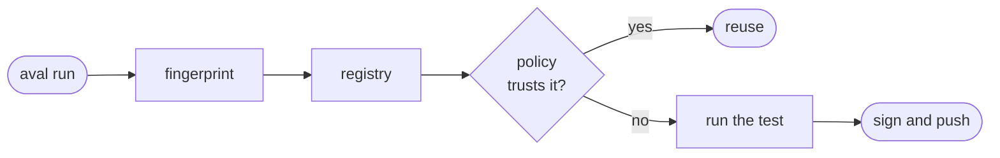

# How Aval works

How does Aval decide to skip a test?

| Step | What happens |
|---|---|
| Fingerprint | hash `aval.yaml` and every input it lists into one `sha256` |
| Registry | look up results stored under that fingerprint |
| Policy | the signer must be one your [policy](trust.md) trusts |
| Reuse or run | trusted: skip the test. Anything else: run it ([Outcomes](outcomes.md)) |
| Push | with `--push`, sign the new result and store it |

- No proof, no reuse: the test runs.
- Aval does not guess inputs. A file `aval.yaml` does not list is invisible.
- No server: results live in an OCI registry you already have.

See it: [Quickstart](../quickstart.md). Specs: [contract](../contract.md),
[trust model](../trust-model.md), [artifact format](../artifact-format.md).
