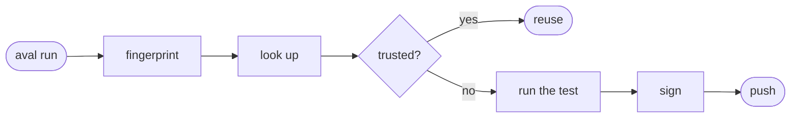

# How Aval works

Aval runs a test once, signs the result and stores it in your OCI registry.
The next job with the same inputs checks that signature and skips the test.

## The steps

| Step | What happens |
|---|---|
| Fingerprint | hash `aval.yaml` and every input it declares into one `sha256` |
| Look up | ask your registry for results under that fingerprint |
| Verify | the signature must come from a signer your [policy](trust.md) trusts |
| Reuse or run | verified: the test is skipped. Anything else: it runs ([Outcomes](outcomes.md)) |
| Push | with `--push`, sign the new result and push it |

If Aval cannot prove reuse is safe, the test runs. See it run:
[Quickstart](../quickstart.md).

## What Aval does not do

- It does not guess inputs: a file the contract does not list is invisible to
  it.
- It runs no server. Results live in an OCI registry you already have.

Details: [the test contract](../contract.md),
[the trust model](../trust-model.md),
[the artifact format](../artifact-format.md).
