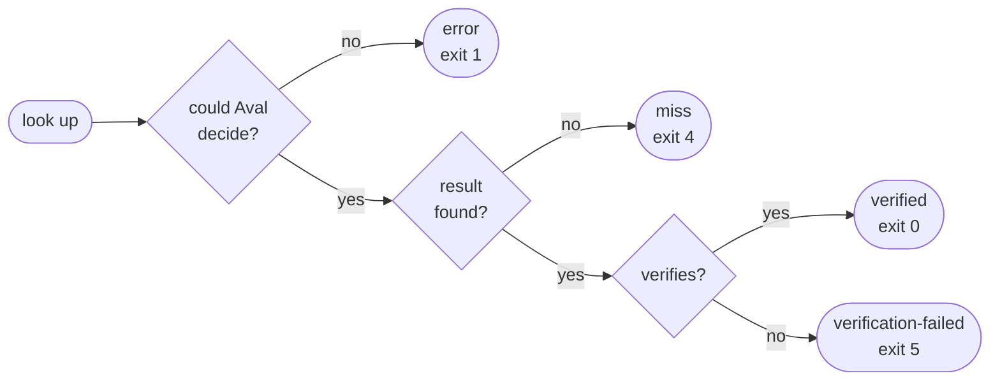

# Outcomes

Every lookup ends in one of four outcomes. Only `verified` skips the test.



The exit codes are those of `aval verify`. `aval run` turns every outcome
except `verified` into a test run.

All exit codes, from the [CLI reference](../cli-reference.md#exit-codes):

--8<-- "docs/cli-reference.md:exit-codes"

## The four outcomes

| Outcome | What it means | `aval run` does |
|---|---|---|
| `verified` | a trusted result exists for these exact inputs | reuses it: exit 0 for a pass, 3 for a failure |
| `miss` | nothing to reuse: the inputs changed, or nobody ran them yet | runs the test |
| `error` | Aval could not decide, such as a registry it cannot reach | runs the test |
| `verification-failed` | a result exists but does not verify | runs the test, then exits 5 |

## A miss is routine

You changed a file, so the fingerprint changed, so there is nothing to reuse
yet. The test runs. This is the normal path for most pull requests.

A few other cases are also a miss: no `--policy`, a `non-deterministic`
test, or a result signed below `minTrustLevel`.

## A verification failure is a security event

Someone pushed a result under your fingerprint that does not verify. The
signature is bad, or the signer is not in your policy, or the result claims
other inputs. The cause can be a wrong policy or an attacker.

Aval runs the test, prints `aval: SECURITY: ...` and exits 5. Do not hide
it and do not retry it away: fail the job and look.

## An example

```console
$ aval verify --registry $REG --policy policy.yaml
miss orders-integration sha256:b40e9fac…
reason: registry.Lookup …: no attestation found for fingerprint
$ echo $?
4
```

In a script, branch on the exit code:

```sh
aval verify --registry "$REG" --policy policy.yaml
case $? in
  0) echo "a trusted result exists" ;;
  4) echo "miss: the test must run" ;;
  5) echo "SECURITY: a result failed verification" >&2; exit 1 ;;
  *) echo "error: the test must run" ;;
esac
```

!!! info "The full spec"
    The JSON report is in the
    [artifact format](../artifact-format.md#verify-report), the commands in
    the [CLI reference](../cli-reference.md).
