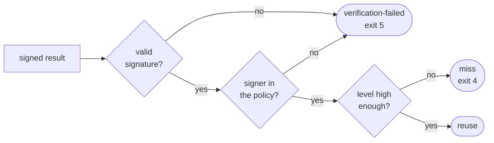

# Trust

Whose results does Aval reuse? Only those of signers **your** policy trusts.
A result cannot vouch for itself.

## Signers and levels

| Signer | Signs with | Usual level |
|---|---|---|
| CI job (keyless) | a short-lived Sigstore certificate for its OIDC identity | runner |
| key | a local ECDSA P-256 key file | developer |

Your policy sets the level. The level a result claims is ignored.

--8<-- "docs/trust-model.md:trust-levels"

## The policy

A YAML file in your repository. This one trusts the `main` workflow as
runner and Alice's key as developer:

--8<-- "docs/trust-model.md:policy-file"

- With `minTrustLevel: runner`, Alice's result is a miss: the test runs.
- No policy: nothing is trusted, every test runs.

## What a signature proves

- **Proves:** who signed, and that nobody changed the result since.
- **Does not prove:** that the test ran honestly, or that inputs outside the
  contract were the same.

Grant a level only to signers you would trust to run the test yourself.
Full spec: [trust model](../trust-model.md).
