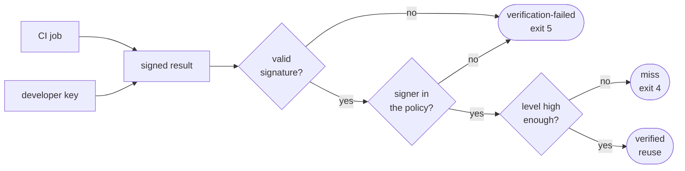

# Trust

A signed result is reused only if **your** policy trusts the signer. The
result cannot vouch for itself.



## Signers

A **signer** is who signed a result. There are two kinds:

- **A CI job (keyless).** The job signs with a short-lived certificate from
  Sigstore, tied to its OIDC identity, such as one GitHub Actions workflow
  on `main`.
- **A key.** A developer signs with a local key file.

## Trust levels

Your policy gives each signer a trust level:

| Level | Name | Use it for |
|---|---|---|
| 1 | developer | skip a test you already ran on your own machine |
| 2 | runner | reuse in CI: a CI job with a verifiable identity |
| 3 | isolated | reuse even when the runner host is not trusted |

The predicate inside a result also claims a level. Aval ignores that claim:
the level always comes from your policy.

## The policy

A policy is a YAML file you keep in your repository. This one trusts the
`main` branch workflow for CI reuse, and Alice's key at developer level:

```yaml
apiVersion: aval.trianalab.io/v1
kind: Policy
minTrustLevel: runner
identities:
  - issuer: https://token.actions.githubusercontent.com
    subjectRegexp: https://github\.com/acme/orders/\.github/workflows/ci\.yaml@refs/heads/main
    trustLevel: runner
  - publicKey: keys/alice.pub
    trustLevel: developer
```

With `minTrustLevel: runner`, a result Alice signed is a miss: the test runs.
Without `--policy`, nothing is trusted and every test runs.

## What a signature proves

- **Proves:** who signed the result, and that nobody changed it since.
- **Does not prove:** that the test ran honestly, or that inputs outside the
  contract were the same.

So only grant a level to signers you would trust to run the test yourself.

!!! info "The full spec"
    [The trust model](../trust-model.md) covers keyless verification, the
    policy fields and the threats Aval defends against.
