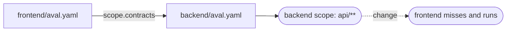

# Depend on another part of the repo

Goal: in a monorepo, rerun the frontend tests when the backend's inputs
change, without copying the backend's globs.



## The example

The frontend names the backend's contract:

```yaml title="frontend/aval.yaml"
--8<-- "tests/acceptance/testdata/monorepo/frontend/aval.yaml"
```

```yaml title="backend/aval.yaml"
--8<-- "tests/acceptance/testdata/monorepo/backend/aval.yaml"
```

The frontend's fingerprint now includes the backend's:

- a change in the backend's scope: the frontend misses and runs;
- a change outside it (a backend README): still reused;
- contracts the backend names count too.

`aval explain` shows the link:

```text
contract ../backend/aval.yaml backend sha256:<backend fingerprint>
depends on ../backend/aval.yaml (backend) sha256:<backend fingerprint>
```

- Paths are relative and stay inside the git working tree. No other repositories.
- If Aval cannot read the other contract, the test runs.
- A mutable reference in the backend blocks the frontend too; only the
  backend's `scope.allowMutable` accepts it.

Using only the backend's interface (a generated client)? List the API file
(OpenAPI, `.proto`) in `scope.dependencies` instead.

## Workspaces

uv, pnpm and cargo keep one lockfile at the root, and globs cannot use `..`.
Two layouts work. Either one contract per member at the root:

```yaml title="aval.api.yaml"
--8<-- "tests/acceptance/testdata/workspace/aval.api.yaml"
```

Or a root contract owns the lockfile, and members name it (`scope.contracts`
may use `..`):

```yaml title="aval.lock.yaml"
--8<-- "tests/acceptance/testdata/workspace/aval.lock.yaml"
```

```yaml title="packages/api/aval.yaml"
--8<-- "tests/acceptance/testdata/workspace/packages/api/aval.yaml"
```

Any lockfile change reruns every member.

| Tool | Root files to hash |
|---|---|
| uv | `pyproject.toml`, `uv.lock` |
| pnpm | `package.json`, `pnpm-workspace.yaml`, `pnpm-lock.yaml` |
| cargo | `Cargo.toml`, `Cargo.lock` |

Also check root config (`tsconfig.base.json`, `conftest.py`,
`.cargo/config.toml`), patches, build scripts and shared fixtures:
[find undeclared inputs](write-a-contract.md#find-undeclared-inputs).

## Read next

- [Write a contract](write-a-contract.md)
- [The test contract](../contract.md): every field and rule
