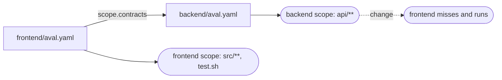

# Depend on another part of the repo

Goal: in a monorepo, rerun the frontend tests when the backend's declared
inputs change, without copying the backend's globs.



## The example

The frontend names the backend's contract:

```yaml title="frontend/aval.yaml"
--8<-- "tests/acceptance/testdata/monorepo/frontend/aval.yaml"
```

```yaml title="backend/aval.yaml"
--8<-- "tests/acceptance/testdata/monorepo/backend/aval.yaml"
```

The frontend's fingerprint now includes the backend contract's fingerprint.
A change to a file in the backend's scope makes the frontend miss and run.
A change to a backend file outside that scope (a README) keeps the reuse.
References are transitive: if the backend names another contract, its
inputs count too.

`aval run --explain` prints the tree after the manifest:

```text
contract ../backend/aval.yaml backend sha256:8441...
depends on ../backend/aval.yaml (backend) sha256:8441...
```

## Rules

- Paths are relative to the contract that names them and must stay inside
  the git working tree (the nearest directory with a `.git` entry). No
  symlinks on the way, no cycles, at most 8 levels and 64 contracts.
- Anything Aval cannot prove fails closed: a missing or invalid contract, a
  scope that matches nothing, an unresolvable `scope.resolve`. The test runs.
- A mutable reference the backend's scanner finds blocks the frontend's reuse
  too. Only the backend's own `scope.allowMutable` can accept it.
- Only local files. A contract in another repository cannot be referenced.

## A contract, or an API file?

Point at a contract when the test exercises the other part's code: the
frontend end-to-end tests start the real backend, so every backend input
matters.

List the API file (an OpenAPI document, a `.proto` file) in
`scope.dependencies` instead when the test only relies on the interface:
the frontend unit tests use a generated client and a mocked backend. Then
only an interface change reruns them, not every backend edit. Globs cannot
reach outside the contract's directory, so keep the API file in the
frontend's tree (a vendored copy, a shared `api/` directory under it).

## Read next

- [Write a contract](write-a-contract.md)
- [The test contract](../contract.md): every field and rule
