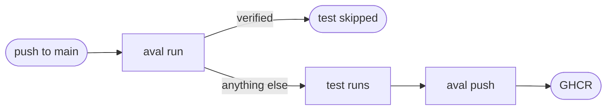

# Use Aval in GitHub Actions

Goal: a workflow on `main` that reuses a verified test result, or runs the
test and publishes a signed one.



## The example

These are the steps of the `example-go-compose` job in Aval's own
[`ci.yaml`](https://github.com/TrianaLab/aval/blob/main/.github/workflows/ci.yaml).
They run on every push to `main`. Copy them into your job and set three
variables: `REPO` (your registry repository), `CONTRACT` (your `aval.yaml`)
and `POLICY` (your trust policy).

The job needs these permissions:

```yaml
--8<-- ".github/workflows/ci.yaml:gha-permissions"
```

The steps log in to GHCR, run the test or reuse the result, and publish a new
result signed with the workflow's identity:

```yaml
--8<-- ".github/workflows/ci.yaml:gha-steps"
```

Install `aval` in an earlier step with the
[installer](../install.md#linux-and-macos).

## What happens

1. `aval run` fingerprints the inputs and looks in `REPO`.
2. If a trusted result exists, the test does not run (outcome `verified`).
3. Otherwise the test runs. The step then asks GitHub for an OIDC token and
   `aval push` signs the result with it and publishes it.
4. If the test fails (exit 3) or a result does not verify (exit 5), the step
   fails and nothing is pushed.

The policy for this job trusts only this workflow on `main`:

```yaml
--8<-- "examples/go-compose/policy.yaml"
```

??? info "Why the token is fetched after the test"
    The OIDC token is short-lived. Fetching it after the test means a slow
    test cannot outlive it. `aval push` reads it from `$SIGSTORE_ID_TOKEN`;
    `runner.command` never sees it.

??? info "Pull requests"
    `packages: write` and `id-token: write` are write scopes, so this job runs
    only on push to `main`. A pull request job can still reuse: give it
    `contents: read`, run `aval run` with `--registry` and `--policy`, and
    leave out the push. GHCR packages that are public can be read without a
    login.

??? info "Fail on a security event"
    `aval run` exits 5 when a result under your fingerprint does not verify.
    Do not add `|| true` around it. See
    [Outcomes](../concepts/outcomes.md#a-verification-failure-is-a-security-event).

## Read next

- [Sign with a key or keyless](signing.md)
- [Write a trust policy](trust-policy.md)
- [Measure reuse](measure-reuse.md)
