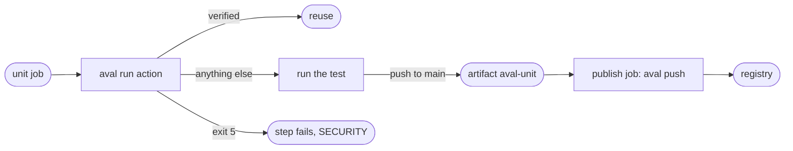

# Use GitHub Actions

Goal: each CI job runs its test through Aval in three lines of YAML, and only
a job on `main` signs and publishes results.



## The example

A suite job:

```yaml
--8<-- "docs/includes/github-actions.yml:run"
```

The action [`integrations/github/run`](https://github.com/TrianaLab/aval/blob/main/integrations/github/run/action.yml)
takes `test` (required), `file` (default `aval.yaml`) and `policy` (default
`.github/aval/policy.yaml`). In order, it:

1. Refuses `pull_request_target` and `workflow_run`, and fails when the job
   has `id-token: write`: a suite job can never sign.
2. Installs the aval release pinned in its `action.yml`, checked against the
   per-platform sha256, the release signature and the provenance
   ([Install](../install.md)). Pinning the action by commit SHA pins aval too.
3. Fetches the policy from the default branch through the contents API with
   `github.token`, on every event, never from the checkout. The registry
   comes from the policy's `registry` field
   ([Write a trust policy](trust-policy.md)); the job's `AVAL_REGISTRY` and
   `AVAL_POLICY` are ignored. With no policy nothing is reused, the test
   runs and a warning is logged.
4. Runs `aval run -f <file> --test <test>` with the CI run URL and the
   repository for the run record.
5. Writes the outcome to the step summary and the `outcome` output. Exit 5
   sets the outcome to `verification-failed`, becomes an `aval SECURITY`
   error annotation and fails the step; a miss is routine.
6. On a push to the default branch only, uploads `.aval/<test>/` as the
   artifact `aval-<test>`.
7. Warns when the policy trusts a `refs/pull/` subject at or above
   `minTrustLevel`.

The policy is a separate file on the default branch, so `publicKey` paths in
it are not fetched; use keyless identities.

The action runs on Linux and macOS runners that ship `/usr/bin/jq`
(GitHub's Ubuntu images, macOS 15 and later).

!!! note "Pinned release"
    The action needs `--test` and the policy's `registry`, which ship in the
    release after 0.7.0. Until its pin moves there (milestone 14, #213),
    `aval run` exits 2 and the step fails.

## Split credentials

The publishing job signs with the workflow's identity and pushes what the
suite job uploaded:

```yaml
--8<-- "docs/includes/github-actions.yml:publish"
```

- The OIDC token is fetched in the publishing job, which runs no tests.
- `--test` names the test the artifact holds, so a report for another test
  cannot be published under this one.
- A report whose outcome is `verified` (also under `--shadow`) makes push
  print `nothing to push: ...`, sign nothing and exit 0. So does a
  `non-deterministic` test.
- A `miss` or an `error` publishes the result. Failing results are published
  on purpose: on a tie in trust level a failure outranks a pass, so a later
  flaky pass cannot become reusable.
- The result and the report come from an unprivileged job and are unsigned.
  Push checks that both match the test id and the fingerprint it computes
  now from the checkout, then signs the result's claims with the publishing
  identity. A mismatch exits 1 and publishes nothing.
- A report that records a security event (outcome `verification-failed`, or
  a `rejected` entry that failed verification) signs nothing and exits 5. The
  suite job already exited 5 for it: investigate before publishing.
- Trust only this workflow on `main`: [Write a trust policy](trust-policy.md#the-example).

## Pull requests

A pull request runs the same suite job and reuses what `main` published. Its
own policy edits change nothing, because the policy comes from the default
branch. The workflow file itself still comes from the PR, so a hostile PR can
make its own check green; required code-owner review is what protects `main`
([protected branch](../trust-model.md#take-the-policy-from-a-protected-branch)).

## Read next

- [Sign results](signing.md)
- [Shards and matrices](shards-and-matrices.md)
- [Measure reuse](measure-reuse.md)
