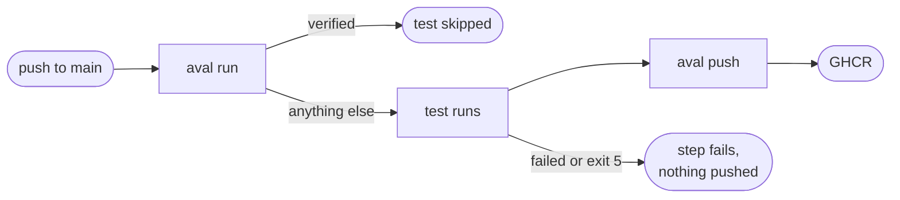

# Use GitHub Actions

Goal: a workflow on `main` that reuses a verified test result, or runs the
test and publishes a signed one.



## The example

Copy these steps from Aval's own
[ci.yaml](https://github.com/TrianaLab/aval/blob/main/.github/workflows/ci.yaml)
and set `REPO`, `CONTRACT` and `POLICY`. Install `aval` first with the
[installer](../install.md#linux-and-macos).

The job needs these permissions:

```yaml
--8<-- ".github/workflows/ci.yaml:gha-permissions"
```

The steps log in to GHCR, run the test or reuse the result, and publish a new
result signed with the workflow's identity:

```yaml
--8<-- ".github/workflows/ci.yaml:gha-steps"
```

Trust only this workflow on `main`: see
[Write a trust policy](trust-policy.md#the-example).

??? info "Why the token is fetched after the test"
    The OIDC token is short-lived. Fetching it after the test means a slow
    test cannot outlive it. `aval push` reads it from `$SIGSTORE_ID_TOKEN`;
    `runner.command` never sees it.

??? info "Pull requests"
    `packages: write` and `id-token: write` are write scopes, so this job runs
    only on push to `main`. A pull request job can still reuse: give it
    `contents: read`, run `aval run` with `--registry` and `--policy`, and
    leave out the push. GHCR packages that are public can be read without a
    login.
    Read the policy from the default branch, not from the PR:
    [Take the policy from a protected branch](../trust-model.md#take-the-policy-from-a-protected-branch).

## Read next

- [Shards and matrices](shards-and-matrices.md): one job per shard
- [Sign with a key or keyless](signing.md)
- [Write a trust policy](trust-policy.md)
- [Measure reuse](measure-reuse.md)
