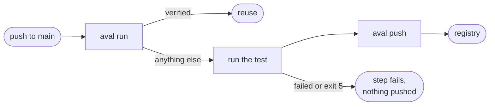

# Use GitHub Actions

Goal: a workflow on `main` that reuses a verified test result, or runs the
test and publishes a signed one.



## The example

From Aval's own
[ci.yaml](https://github.com/TrianaLab/aval/blob/main/.github/workflows/ci.yaml).
Set `REPO`, `CONTRACT` and `POLICY`, and [install](../install.md#linux-and-macos) `aval` first.

Permissions:

```yaml
--8<-- ".github/workflows/ci.yaml:gha-permissions"
```

Steps: log in to GHCR, run or reuse, then sign with the workflow's identity
and push:

```yaml
--8<-- ".github/workflows/ci.yaml:gha-steps"
```

- The OIDC token is fetched after the test, so a slow test cannot outlive
  it. `runner.command` never sees it.
- Trust only this workflow on `main`: [Write a trust policy](trust-policy.md#the-example).
- The snippet keeps the outcome check until the pinned release has
  `aval push --report-file` (see [Split credentials](#split-credentials)).

## Split credentials

To keep signing credentials away from the test, run the suite in a job
without them and sign in a second job. The suite job keeps both files:

```sh
aval run -f "$CONTRACT" --result-file R --report-file P
```

The publishing job downloads them and runs one command per result:

```sh
aval push -f "$CONTRACT" --registry "$AVAL_REGISTRY" --result-file R --report-file P
```

- When the report's outcome is `verified` (also under `--shadow`), push prints
  `nothing to push: ...`, signs nothing and exits 0, even if a stale result
  file is present.
- Any other outcome publishes the result, as `aval run --push` would. Failing
  results are published on purpose: on a tie in trust level a failure
  outranks a pass, so a later flaky pass cannot become reusable.
- The result and the report come from an unprivileged job and are unsigned.
  Push checks that both match the test id and the fingerprint it computes
  now, then signs the result's claims with the publishing identity. Decide
  which job may supply which files in your workflow.
- A verification failure stays the suite job's security event: it already
  exits 5. Push does not repeat it.

## Pull requests

Write scopes mean the job above runs only on `main`. A PR job can still reuse:

- `contents: read`, no push step;
- set `AVAL_REGISTRY` and `AVAL_POLICY` (or the flags);
- public GHCR packages can be read without a login;
- read the policy from the default branch, not the PR:
  [protected branch](../trust-model.md#take-the-policy-from-a-protected-branch).

## Read next

- [Sign results](signing.md)
- [Shards and matrices](shards-and-matrices.md)
- [Measure reuse](measure-reuse.md)
