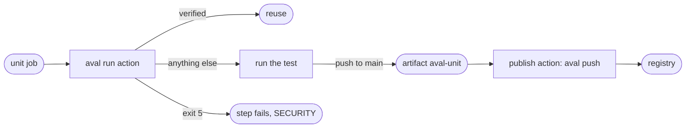

# Use GitHub Actions

Goal: each CI job runs its test through Aval in three lines of YAML, and one
job on `main` signs and publishes every result.



## The example

A suite job:

```yaml
--8<-- "docs/includes/github-actions.yml:run"
```

The action [`integrations/github/run`](https://github.com/TrianaLab/aval/blob/main/integrations/github/run/action.yml)
takes `test` (required), `file` (default `aval.yaml`) and `policy` (default
`.github/aval/policy.yaml`). In order, it:

1. Refuses `pull_request_target` and `workflow_run`, and fails when the job
   has `id-token: write`: a suite job can never sign.
2. Installs the aval release pinned in its `action.yml`, checked against the
   per-platform sha256, the release signature and the provenance
   ([Install](../install.md)). Pinning the action by commit SHA pins aval too.
3. Fetches the policy from the default branch through the contents API with
   `github.token`, on every event, never from the checkout. The registry
   comes from the policy's `registry` field
   ([Write a trust policy](trust-policy.md)); the job's `AVAL_REGISTRY` and
   `AVAL_POLICY` are ignored. With no policy nothing is reused, the test
   runs and a warning is logged.
4. Runs `aval run -f <file> --test <test>` with the CI run URL, the
   repository and, on a push to the default branch, `--outputs-dir`.
5. Writes the outcome to the step summary and the `outcome` output. Exit 5
   sets the outcome to `verification-failed`, becomes an `aval SECURITY`
   error annotation and fails the step; a miss is routine.
6. On a push to the default branch only, uploads `.aval/<test>/` as the
   artifact `aval-<test>`.
7. Warns when the policy trusts a `refs/pull/` subject at or above
   `minTrustLevel`.

The policy is a separate file on the default branch, so `publicKey` paths in
it are not fetched; use keyless identities. The action needs `/usr/bin/jq`
(GitHub's Ubuntu images, macOS 15 and later).

!!! note "Pinned release"
    Pinning an action by commit SHA pins its aval release too (version and
    sha256, moved by a PR after each release). The actions need `--test` and
    the policy's `registry`, which ship after 0.7.0; until that pin merges
    (milestone 14), `aval run` and `aval push` exit 2 and the step fails.

## Split credentials

One job signs what the suite jobs uploaded, with the workflow's identity:

```yaml
--8<-- "docs/includes/github-actions.yml:publish"
```

The action [`integrations/github/publish`](https://github.com/TrianaLab/aval/blob/main/integrations/github/publish/action.yml)
takes `file`, `policy`, `registry-username`, `registry-password` (default
`github.actor` and `github.token`), `stats` and `allow-unprotected` (both
default `false`). In order, it:

1. Refuses a ref other than the default branch unless `allow-unprotected:
   true`, always refuses `pull_request_target` and `workflow_run`, and fails
   without `id-token: write`.
2. Installs the same pinned, verified aval release as the run action.
3. Fetches the policy from the default branch and logs in to the host of its
   `registry`, where results go. No policy or no `registry` fails the step.
4. Downloads this run's `aval-*` artifacts (so name no other artifact
   `aval-*`) into `$RUNNER_TEMP`. For each `aval-<name>`, fetches a fresh OIDC
   token (audience `sigstore`) and runs `aval push --test <name>`. It tries
   them all, then exits with the worst code; 5 is `aval SECURITY`, never downgraded.
5. With `stats: true`, publishes each pushed test's run record; a failure
   is a warning.

What `aval push` does with each artifact:

- An artifact `aval-a` that holds test `b`, or a result that does not match
  the fingerprint push computes from the checkout, exits 1 and publishes
  nothing; the other artifacts are still pushed.
- A reused result (report outcome `verified`, also under `--shadow`) and a
  `non-deterministic` test print `nothing to push: ...` and exit 0.
- A `miss` or an `error` publishes the result, failures included: on a tie
  in trust level a failure outranks a later flaky pass.
- A report that records a security event signs nothing and exits 5.
- The artifact holds `result.json`, `report.json`, `record.json` and
  `outputs/<path>`, the files the `outputs` globs matched; push publishes
  those, never the checkout's. No `outputs/` for a test with outputs, or a
  symlink, extra file, input, `.git` or `.aval` in it, exits 1, publishing nothing.
- Trust only this workflow on `main`: [Write a trust policy](trust-policy.md#the-example).

### Why a composite action

The publish action is a composite action, not a reusable workflow: its steps
run in the caller's job, so the Fulcio certificate names the calling workflow
(`https://github.com/acme/app/.github/workflows/ci.yaml@refs/heads/main`). A
reusable workflow would put Aval's workflow in every caller's certificate, and
one `subjectRegexp` would trust them all. Aval's CI checks this.

## Pull requests

A pull request runs the same suite job and reuses what `main` published. Its
own policy edits change nothing, because the policy comes from the default
branch. The workflow file itself still comes from the PR, so a hostile PR can
make its own check green; required code-owner review is what protects `main`
([protected branch](../trust-model.md#take-the-policy-from-a-protected-branch)).

## Read next

- [Sign results](signing.md)
- [Shards and matrices](shards-and-matrices.md)
- [Measure reuse](measure-reuse.md)
