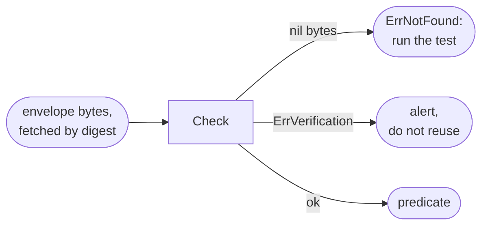

# Consume from Go

Goal: check an Aval result from your own Go program with `pkg/evidence`, and
tell a miss from a security event.



## The example

```sh
go get github.com/TrianaLab/aval@latest
```

`Check` from
[`examples/evidence-consumer`](https://github.com/TrianaLab/aval/blob/main/examples/evidence-consumer/consumer.go),
a module that imports only `pkg/evidence`:

```go
--8<-- "examples/evidence-consumer/consumer.go:check"
```

| `Check` returns | Do |
|---|---|
| a predicate with `Result == evidence.ResultPassed` | reuse it |
| `evidence.ErrNotFound` | a miss: run the test |
| `evidence.ErrVerification` | alert, run the test, do not reuse |
| a predicate with another `Result` | a trusted failure: the test failed |

## What you bring

- **Envelope bytes**, fetched by digest with any registry client
  ([layout](../artifact-format.md)).
- **A `SignatureVerifier`.** `pkg/evidence` checks the policy, not the
  cryptography. The example brings ed25519; a Sigstore one is planned for
  milestone 5.
- **Identities** from your own policy, never from the predicate.

Reading `aval verify -o json` instead? Use `evidence.Report`, as the
example's `Reuse` does.

## Read next

- [Consume evidence](../integrations.md): every symbol of `pkg/evidence`
- [Outcomes](../concepts/outcomes.md)
