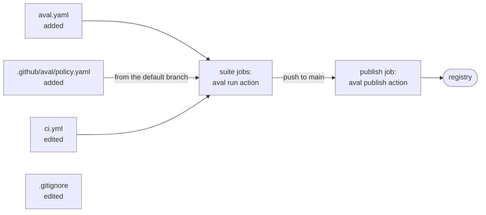

# Integrate Aval in 5 files

Goal: put a monorepo's CI on Aval by adding 2 files and editing at most 3,
without touching the Makefile or the scripts.



The example is [`examples/github-monorepo`](https://github.com/TrianaLab/aval/tree/main/examples/github-monorepo):
a Go module (`cmd/`, `internal/`, `pkg/`), a Node UI, a Dockerfile, a data
directory, an end-to-end suite in 3 shards and one suite that calls an
outside service. Aval's tests check that its integration is exactly these
files, and run every test through the CLI.

## 1. Add `aval.yaml`

One TestSet: `defaults` for every test, a fragment per part of the repo, and
a `matrix` for the shards. Each test reads only its fragments, so a change to
`ui/` reruns `ui` and nothing else:

```yaml
--8<-- "examples/github-monorepo/aval.yaml"
```

- `allowMutable[].files` accepts the one tag the data fixtures share, in
  those files only. The same tag anywhere else blocks reuse.
- `outputs` restores `coverage.out` when `unit` is reused.
- Check every test without running anything: `aval explain --all`.

Leave out what must always run: a `non-deterministic` test is never reused,
and an `external-dependencies` test only when the policy lists it in
`allowedCacheability` ([Trust model](../trust-model.md)). Here
`test-external` stays a plain `make` job.

## 2. Add the trust policy

One runner identity, this workflow on `main`, and the registry results go to:

```yaml
--8<-- "examples/github-monorepo/.github/aval/policy.yaml"
```

## 3. Edit the workflow

In each suite job, the `make` step becomes the run action:

```yaml
--8<-- "examples/github-monorepo/.github/workflows/ci.yml:run"
```

A matrix job names its shard, so each shard is its own test and artifact:

```yaml
--8<-- "examples/github-monorepo/.github/workflows/ci.yml:matrix"
```

Add one publish job:

```yaml
--8<-- "examples/github-monorepo/.github/workflows/ci.yml:publish"
```

## 4. Ignore `.aval/`

Add `.aval/` to `.gitignore`: each test writes its result there. Optionally,
say in `CONTRIBUTING.md` that CI reuses results.

Each action installs the aval release its commit pins. The example pins
the commit that pins the latest release.

The run action's artifact carries `coverage.out`, the output of `unit`, and
the publish job pushes it from there, not from its own checkout
([the artifact](github-actions.md#split-credentials)).

## Before you start

Pinning is project work, not part of these files: base images by digest,
lockfiles in `scope.dependencies`, tools at fixed versions. Until then
Aval reports each mutable reference and reuses nothing for that test
([Pin your dependencies](../pinning.md)).

## Security

- Require code-owner review of `.github/workflows/` and `.github/aval/`: a
  pull request controls its own workflow file.
- Trust `refs/heads/main` only. A runner-level identity for `refs/pull/`
  lets any pull request sign results that are reused.
- Publish only on a push to the default branch, from a job that runs no tests.
- The publish action is a composite action, not a reusable workflow, so the
  certificate names your workflow ([Why a composite action](github-actions.md#why-a-composite-action)).

## Other CI systems

A wrapper for another CI system has the same duties as the two actions:

- Install a pinned aval release and verify it (sha256, signature).
- Read the policy from the protected branch, never from the checkout.
- Give suite jobs no signing credentials; sign in a separate job.
- Never swallow exit 5: fail the job and show the security event.
- Keep one artifact per test (`.aval/<test>/`), named after the test.
- Publish only on protected refs, with that job's own identity.

## Read next

- [Use GitHub Actions](github-actions.md)
- [Shards and matrices](shards-and-matrices.md)
- [Write a trust policy](trust-policy.md)
