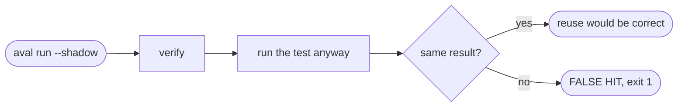

# Measure reuse

Goal: find out how often Aval would reuse a result, and whether reuse would
have been right, before you let it skip any test.



## Estimate from history

[`scripts/estimate-reuse.sh`](https://github.com/TrianaLab/aval/blob/main/scripts/estimate-reuse.sh)
fingerprints past commits and counts repeats as hits:

```sh
scripts/estimate-reuse.sh services/orders/aval.yaml --max-count=200 main
```

```text
<commit> miss sha256:4800...
<commit> hit sha256:4800...
200 commits, 61 would reuse a result (30%, an upper bound)
```

An upper bound: it ignores branches, failing tests and trust policy.

## Measure in shadow mode

Verify, run the test anyway, compare, and record the run:

```sh
aval run --shadow --stats
```

| You see | It means |
|---|---|
| `shadow: reuse of <ref> would have been correct` | safe to turn shadow off for this test |
| `aval: FALSE HIT: ...` (exit 1) | the contract misses an input: fix `scope` |

No write access in the test job? Write the record to a file and publish it
from another job:

```sh
aval run --stats-file record.json --source-repo acme/orders
aval stats publish --registry ghcr.io/acme/aval-stats record.json
```

## Read the numbers

```sh
aval stats --registry ghcr.io/acme/aval-stats --since 7d
```

It sums hits, misses by cause, verification failures, shadow false hits and
time saved, per test.

- `--test` limits it to one test, `--by repository` groups by `--source-repo`,
  `-o json` prints the [stats report](../artifact-format.md#stats-report-json).
- Records are unsigned statistics. `aval run` and `aval verify` never read
  them, so a forged record cannot cause reuse.
- A record that cannot be published only warns; the exit code stays.
  Fields: [run records](../artifact-format.md#record-json).

## Read next

- [Stats](../stats.md): the public numbers
- [Troubleshooting](troubleshooting.md)
