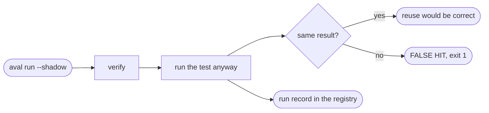

# Measure reuse

Goal: find out how often Aval would reuse a result, and whether reuse would
have been right, before you let it skip any test.



## The example

Run in shadow mode and record every run:

```sh
aval run --shadow --record --registry ghcr.io/acme/orders-aval --policy policy.yaml
```

`--shadow` verifies as usual, then runs the test anyway. If a verified result
exists and agrees with the run, Aval prints
`shadow: reuse of <reference> would have been correct`. If it disagrees, Aval
prints `aval: FALSE HIT: ...` and exits 1. A false hit usually means the contract
misses an input: fix the scope before you turn shadow mode off.

`--record` publishes one run record per run. A record looks like this:

```json
--8<-- "pkg/evidence/testdata/run-record-v1.golden.json"
```

## Record from where you can write

=== "Same job"

    The job that runs the test has write access to the registry:

    ```sh
    aval run --record --registry ghcr.io/acme/orders-aval --policy policy.yaml
    ```

=== "Separate job"

    The test job writes the record to a file. A job with write access, which
    runs no tests, publishes it:

    ```sh
    aval run --record-file record.json --registry ghcr.io/acme/orders-aval --policy policy.yaml
    aval record --record-file record.json --registry ghcr.io/acme/orders-aval
    ```

    Aval's own CI does this on `main` for its end-to-end suite.

## Read the numbers

`aval stats`, which sums the records of a test into a table of hits, misses
and time saved, is in progress in
[#88](https://github.com/TrianaLab/aval/issues/88). Until it lands, list the
records yourself:

??? example "List run records with ORAS"
    Records hang off the tag `stats-<test id>`:

    ```sh
    oras discover --artifact-type application/vnd.trianalab.aval.run.v1 ghcr.io/acme/orders-aval:stats-orders-integration
    ```

??? info "Records are statistics, not evidence"
    Records are unsigned. `aval run` and `aval verify` never read them, so a
    forged record cannot cause reuse. Recording is best-effort: a record that
    cannot be published prints `aval: warning: run record not published` and
    never changes the exit code.

??? info "What the fields mean"
    `reused` is true when the test did not run. `savedDurationMs` is how long
    the reused run took when it was recorded. With `--shadow`, `reused` is
    always false. Every field is in
    [Artifact format: run records](../artifact-format.md#record-json).

## Read next

- [Outcomes](../concepts/outcomes.md)
- [Troubleshooting](troubleshooting.md)
