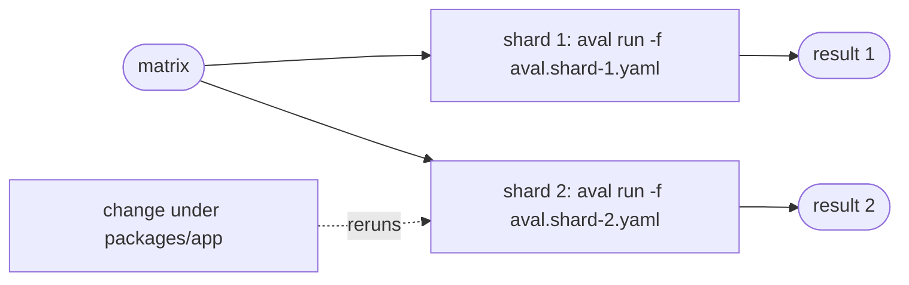

# Shards and matrices

Goal: one result and one fingerprint per CI shard, each bound only to what
that shard reads.



Patterns A and B need no new field: `-f`, `scope` and `environment.env` do
it. Pattern C uses a TestSet `matrix`. Example:
[`examples/uv-monorepo`](https://github.com/TrianaLab/aval/tree/main/examples/uv-monorepo).

## Pattern A: one contract per shard

Best reuse. Each shard has its own contract, side by side at the root:

```yaml
--8<-- "examples/uv-monorepo/aval.shard-1.yaml"
```

Shard 2 tests `app`, which imports `core`, so `core` is in its scope:

```yaml
--8<-- "examples/uv-monorepo/aval.shard-2.yaml"
```

A change under `packages/app` reruns shard 2 only. A change to `core` or
`uv.lock` reruns both.

## Pattern B: one contract, shard variables

Simpler, less reuse: a change anywhere reruns every shard.

```yaml
--8<-- "internal/fingerprint/testdata/shards/pattern-b.yaml"
```

!!! warning "Declare both variables"
    Leave `SHARD_INDEX` or `SHARD_TOTAL` out of `environment.env` and shards
    share a fingerprint: shard 2 reuses shard 1's result, a false hit.

## Pattern C: one TestSet, a `matrix`

One file, and each shard is its own test: `matrix` writes the shard into
`runner.command`, so it is part of the fingerprinted argv and no variable can
drift between the job that runs a shard and the job that pushes it. Reuse
is the same as pattern B, since the shards share one scope. Rules:
[Many tests in one file](../contract.md#many-tests-in-one-file-testset).

```yaml
--8<-- "internal/fingerprint/testdata/shards/pattern-c.yaml"
```

Run one shard by its name; its result goes to `.aval/<name>/`, so shards
never overwrite each other's outputs:

```sh
aval run --test uv-monorepo-shard-0
```

`aval explain --all` checks every shard and prints its fingerprint
([Select a test](../contract.md#select-a-test)).

For a runner that counts shards from 1, `matrix: {shard: {count: 3}}` with
`{shard}/{shard_count}` in the command states the total once, so the shard
list and the total cannot disagree.

## One test per platform

`matrix` also substitutes into `environment.toolchain` values, so each
platform is its own test with its own fingerprint:

```yaml
--8<-- "internal/fingerprint/testdata/shards/platforms.yaml"
```

`unit-darwin` never reuses a result of `unit-linux`. Run the leg of the
machine you are on: the probe of the other leg does not match, so its result
is not recorded. To reuse across platforms, do not declare `platform`.

## The matrix

One job per shard, each with its own `--result-file` and coverage `outputs`:

```yaml
--8<-- "examples/uv-monorepo/workflow.yaml"
```

The same job locally, with `AVAL_REGISTRY` and `AVAL_POLICY` exported as in
the workflow:

```sh
aval run -f aval.shard-2.yaml --result-file .aval/shard-2.json
```

To publish, add the push step from [Use GitHub Actions](github-actions.md).

## Several tests in one job

One job per test pays checkout, setup and the aval install each time. The run action takes several tests in one step instead:

```yaml
--8<-- "docs/includes/github-actions.yml:several"
```

`test` takes names and glob patterns (`*`, `?`, `[...]`) separated by spaces, commas or newlines; a pattern adds the tests it matches, in contract order, and exits 2 when it matches none. Each test gets its own lookup, verification, run and report, one after the other. After them all the step exits with the worst code: a failing test (exit 3) does not skip the rest, and 5 (`aval SECURITY`) is never downgraded. The `outcome` output is the worst outcome (`verified` only when every test is, so `lookup-only` skips setup only then); `outcomes` maps each test to its own, and the step summary has a line per test. On a push to the default branch the tests share one artifact `aval-.<id>`, which the publish action pushes test by test.

The tests share the job and its user: code one test runs can change what the next one reads, as with separate steps of one job. Keep tests that must not touch each other in separate jobs.

## Read next

- [Depend on another part of the repo](depend-on-a-contract.md)
- [Use GitHub Actions](github-actions.md)
