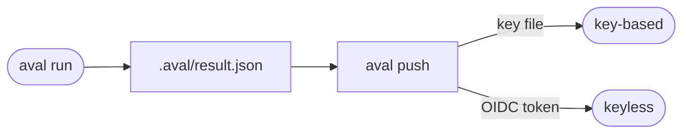

# Sign results

Goal: sign a test result so that others can check who published it.



## The example

=== "Key"

    Make a P-256 key and a policy that trusts it:

    --8<-- "docs/quickstart.md:key"

    Run the test, then sign and push the result:

    --8<-- "docs/quickstart.md:push"

=== "Keyless"

    Put an OIDC token in `$SIGSTORE_ID_TOKEN` and leave out `--key`:

    ```sh
    export SIGSTORE_ID_TOKEN="<OIDC token for audience sigstore>"
    aval run --push --registry ghcr.io/acme/orders-aval
    ```

    On GitHub Actions the job gets the token itself; see
    [Use GitHub Actions](github-actions.md).

    On a laptop, leave out the token too: with a terminal, `aval push` and
    `aval run --push` (once the test has run) open the interactive Sigstore
    login in the browser (`oauth2.sigstore.dev`, client id `sigstore`) and
    sign with the identity you log in with, for example your verified GitHub
    email with issuer `https://github.com/login/oauth`. The token is used for
    that one signature and never stored. `--login` asks for the login without
    a terminal; `$SIGSTORE_OIDC_ISSUER` and `$SIGSTORE_OIDC_CLIENT_ID`
    override the issuer and client id. Give such an identity `developer` in
    the policy. In CI, set `$SIGSTORE_ID_TOKEN` or use `--key`: a terminal
    without a browser prints the login URL and waits for a pasted code.

## Which one

| | Key | Keyless |
|---|---|---|
| Who signs | whoever holds the key file | a CI job or a person, proven by an OIDC token |
| Policy entry | `publicKey: aval.pub` | `issuer` and `subjectRegexp` |
| Typical trust level | `developer` | `runner` |
| Needs network to verify | no | yes, unless the policy pins `trustedRoot` |

??? info "Which keys work"
    An unencrypted ECDSA P-256 key in PEM (PKCS#8 or SEC1). Cosign keys are
    encrypted and do not work. Make one with
    `aval keygen`: it writes `aval.key` (mode 0600) and `aval.pub` and prints
    the key id.

??? info "Sign later with aval push"
    `aval run` records the result in `.aval/result.json`. `aval push` signs and
    publishes it later, with the same `--key` or token. It refuses a result
    whose inputs no longer match the contract:

    ```sh
    aval run --registry ghcr.io/acme/orders-aval --policy policy.yaml
    aval push --registry ghcr.io/acme/orders-aval
    ```

## Read next

- [Write a trust policy](trust-policy.md)
- [Trust](../concepts/trust.md#what-a-signature-proves)
- [Trust model: signing](../trust-model.md#signing)
