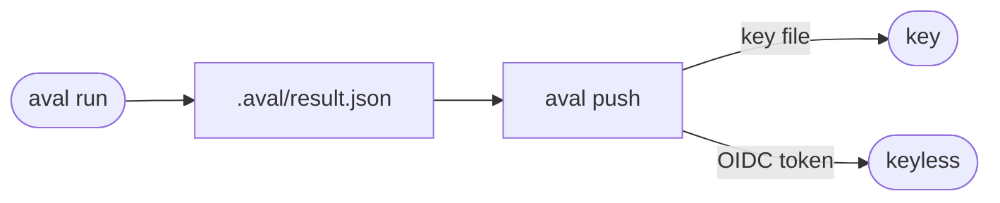

# Sign results

Goal: sign a test result so that others can check who published it.



## The example

=== "Key"

    Make a P-256 key and a policy that trusts it (`aval init --key aval.key`
    does both for a new project):

    ```sh
    aval keygen
    cat > policy.yaml <<'EOF'
    apiVersion: aval.trianalab.io/v1
    kind: Policy
    minTrustLevel: developer
    identities:
      - publicKey: aval.pub
        trustLevel: developer
    EOF
    aval run --push --key aval.key --registry ghcr.io/acme/orders-aval
    ```

=== "Keyless"

    Put an OIDC token in `$SIGSTORE_ID_TOKEN` and leave out `--key`.
    GitHub Actions gets one itself ([Use GitHub Actions](github-actions.md)):

    ```sh
    export SIGSTORE_ID_TOKEN="<OIDC token for audience sigstore>"
    aval run --push --registry ghcr.io/acme/orders-aval
    ```

    On a laptop with a terminal, leave out the token too: Aval opens the
    Sigstore login in the browser and signs with that identity, such as your
    GitHub email. The token is used once, never stored. Give such an identity
    `developer`.

    The identity is your verified GitHub email, issuer
    `https://github.com/login/oauth`. In CI set `$SIGSTORE_ID_TOKEN` or use
    `--key`: a terminal without a browser prints the login URL and waits for
    a pasted code.

## Which one

| | Key | Keyless |
|---|---|---|
| Who signs | whoever holds the key file | a CI job or a person, proven by OIDC |
| Policy entry | `publicKey: aval.pub` | `issuer` and `subjectRegexp` |
| Usual trust level | `developer` | `runner` |
| Network to verify | no | yes, unless the policy pins `trustedRoot` |

- Keys: unencrypted ECDSA P-256 in PEM (PKCS#8 or SEC1). Cosign keys are
  encrypted and do not work.
- `aval push` signs later the result `aval run` saved in `.aval/result.json`.
  It refuses a result whose inputs changed. With `--report-file` it publishes
  nothing after a run that reused a verified result:
  [split credentials](github-actions.md#split-credentials).
- `--login` asks for the browser login without a terminal.
  `$SIGSTORE_OIDC_ISSUER` and `$SIGSTORE_OIDC_CLIENT_ID` override the defaults
  (`oauth2.sigstore.dev`, client `sigstore`).

## Read next

- [Write a trust policy](trust-policy.md)
- [Trust model: signing](../trust-model.md#signing)
