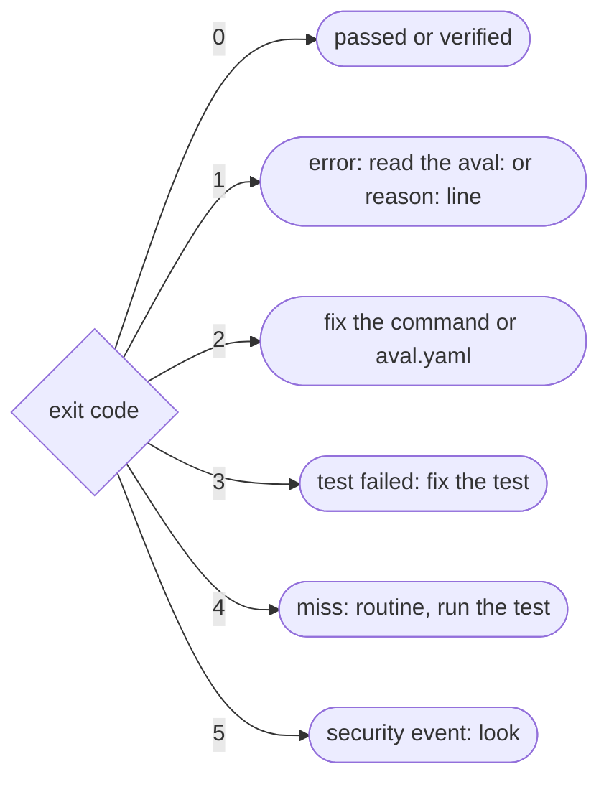

# Troubleshooting

Goal: go from an exit code or an error message to its cause and its fix.



## Start with the exit code

```sh
aval verify --registry ghcr.io/acme/orders-aval --policy policy.yaml; echo "exit $?"
```

--8<-- "docs/cli-reference.md:exit-codes"

Find the message in a section below. Text in `<...>` changes per run.

## Flags and files (exit 2)

??? failure "Flag errors"
    | Message | Fix |
    |---|---|
    | `--push requires --registry`, `--record requires --registry`, `--registry is required`, `--registry and --record-file are required` | add the flags it names |
    | `--shadow and --no-reuse exclude each other` | pick one |
    | `--registry <x> is not an OCI repository` | use `host/name`, no `https://`, tag or digest |
    | `--registry-timeout must be positive`, `--output must be text or json`, `unknown command` | fix the value; see `aval <command> --help` |
    | `signing needs --key or, for keyless signing, an OIDC token` | pass `--key`, or set the token ([Signing](signing.md)) |
    | `not a PEM file`, `PEM type <x> is encrypted`, `not an ECDSA P-256 key` | make an unencrypted P-256 key ([Signing](signing.md)) |
    | `holds neither an Aval result nor a report`, `is an input of the test` | write `--result` and `--report` under `.aval/` |

??? failure "Contract errors"
    | Message | Fix |
    |---|---|
    | `or pass its path with -f` | create `aval.yaml`, or pass `-f path/to/aval.yaml` |
    | `apiVersion: got <x>, want <y>`, `that is the pre-freeze version`, `kind: got <x>, want <y>` | set `apiVersion: aval.trianalab.io/v1`, `kind: Test` |
    | `decoding contract: <x>`, `multiple YAML documents are not allowed` | fix the YAML or the misspelt field; keep one document |
    | `metadata.name: <x> must be 1-64 chars` | lower case letters, digits, `.`, `_`, `-` |
    | `runner.command: must be a non-empty argv list` | `command: ["go", "test", "./..."]` |
    | `scope.source: at least one glob is required` | list the files the test reads |
    | `empty glob`, `must be a relative, slash-separated path`, `empty, '.' or '..' segments are not allowed`, `'**' must be a whole path segment` | write globs like `src/**/*.go` |
    | `cacheability: required`, `cacheability: unknown class` | pick a [class](write-a-contract.md#step-by-step) |
    | `environment.toolchain: invalid key`, `invalid variable name` | lower case tool names, valid variable names |
    | `scope.allowMutable[<i>]: ref and reason are both required` | give each entry a `ref` and a `reason` ([Pin your dependencies](../pinning.md#accept-a-reference-on-purpose)) |
    | `scope.resolve[<i>]: <x>`, `unknown kind <x>`, `the reference must be non-empty`, `credentials in the reference are not allowed`, `a scope.resolve entry is one` | one `kind: reference` per entry, a known kind, no spaces, no credentials ([Resolve references](../resolve/index.md)) |
    | `not a valid <kind> package name`, `is not a registry version, range or tag`, `want group:artifact:version` | a registry name that follows the ecosystem's naming rules and a version, range or tag, not a path, file or URL ([Resolve references](../resolve/index.md#exact-or-floating)) |

## Errors (exit 1)

`aval verify` exits 1. `aval run` prints the lookup errors below as outcome
`error` with a `reason:` line, runs the test anyway and exits with its code
(0 or 3). It exits 1 only when the test cannot start (`running <x>`) or the
result cannot be published.

??? failure "Fingerprint and trust policy"
    | Message | Fix |
    |---|---|
    | `scope.source matched no files`, `glob <x> matched no files` | fix the glob, or create the file |
    | `is excluded only by a trailing` | exclude the file by name |
    | `only regular files are supported in scope`, `control characters in path are not supported` | keep symlinks and odd names out of scope |
    | `resolve <kind> <ref>: <x>` | a `scope.resolve` reference did not resolve: check the name, the version, the network and the credentials ([Resolve references](../resolve/index.md)) |
    | `decoding policy: <x>`, `minTrustLevel: <x> must be developer, runner or isolated`, `identities: at least one is required`, `identities[<i>]: <x>`, `trustLevel: <x> must be developer, runner or isolated` | fix the field ([Write a trust policy](trust-policy.md)) |
    | `publicKey cannot be combined with issuer or subjectRegexp`, `issuer and subjectRegexp are required (or publicKey)` | one kind of signer per identity |
    | `publicKey: <x>`, `publicKey <file>: <x>`, `not a PEM public key`, `larger than <n> bytes`, `subjectRegexp: <x>` | fix the key file or the regexp |
    | `allowedCacheability: non-deterministic results are never reusable`, `allowedCacheability: unknown class` | remove that class |
    | `sigstore trusted root: <x>` | allow network and a writable `$HOME`, or pin `trustedRoot` |

??? failure "Registry, push and record"
    | Message | Fix |
    |---|---|
    | `loading registry credentials: <x>`, `resolving <tag>: <x>`, `listing referrers: <x>`, `fetching manifest <x>`, `fetching layer <x>` | check the address, the network and `docker login` |
    | `signing: <x>`, `publishing: <x>`, `pushing manifest: <x>`, `tagging anchor: <x>` | check the token or key, and write access |
    | `more than <n> attestations for fingerprint` | delete old results ([cleanup](../artifact-format.md#the-64-candidate-cap-and-cleanup)) |
    | `is not listed among the referrers of` | the registry did not list the pushed result in time, or does not support the OCI 1.1 referrers API: push again, or use a registry with referrers support |
    | `running <x>` | install the program `runner.command` starts |
    | `writing report: <x>`, `result not published: <x>` | fix the `--report` path, or the fingerprint error before it |
    | `reading the result recorded by 'aval run'` | run `aval run` first |
    | `recorded result is for test <x>` | an input changed: run the test again |
    | `reading run record: <x>`, `run record <file>: <x>` | pass the file that `--record-file` wrote |
    | `warning: run record not` | a warning only; check write access |

## Misses (exit 4)

??? info "Why nothing was reused"
    | Reason | Fix |
    |---|---|
    | `no attestation found for fingerprint` | none: the inputs changed or nobody pushed yet |
    | `no trust policy configured`, `no registry configured`, `reuse disabled (--no-reuse)` | pass `--policy`, `--registry`, drop `--no-reuse` |
    | `cacheability <x> is never reusable`, `is not in allowedCacheability` | by design, or allow the class in the policy |
    | `not reusable under the trust policy`, `signer <x> has trust level <y>, policy requires at least <z>` | the signer is below `minTrustLevel`; raise its `trustLevel` if you trust it |
    | `mutable references in the inputs` | pin each reference the line lists, or acknowledge it with `scope.allowMutable` ([Pin your dependencies](../pinning.md)) |
    | `every listed attestation is gone`, `is gone, skipping it` | someone deleted results during the lookup: run again |

## Verification failures (exit 5)

`aval: SECURITY: <n> attestation(s) for <test> failed signature or policy verification`
comes first. The `reason:` line says why. A wrong policy is the common cause;
an attacker is the dangerous one. Fail the job and look.

??? danger "Reasons"
    | Reason | Fix |
    |---|---|
    | `signature: <x>`, `signer key id <x> is not in the trust policy`, `it lists no keyless identities`, `is not accepted by the policy` | trust that signer, or find out who pushed |
    | `bundle signs a different envelope`, `no Sigstore bundle stored with the attestation`, `decoding Sigstore bundle`, `bundle does not carry a DSSE envelope`, `envelope: missing or not an in-toto payload`, `decoding statement`, `statement: type <x>`, `predicate: <x>`, `malformed attestation: <x>` | a broken or forged result: delete it |
    | `fingerprint <x>, want <y>`, `test id <x>, want <y>`, `statement subject does not match the predicate subject` | a result that claims other inputs: delete it |
    | `cacheability <x> is not reusable under the policy`, `cacheability <x>, want <y>`, `tag <x> points at <y>, not the fingerprint anchor` | a lie about the result or the tag: find out who pushed |
    | `no signature verifier configured`, `expected fingerprint and test id are required` | only from Go: fill in `VerifyOptions` ([Consume from Go](go-consumer.md)) |

## Read next

- [Outcomes](../concepts/outcomes.md)
- [CLI reference](../cli-reference.md#exit-codes)
