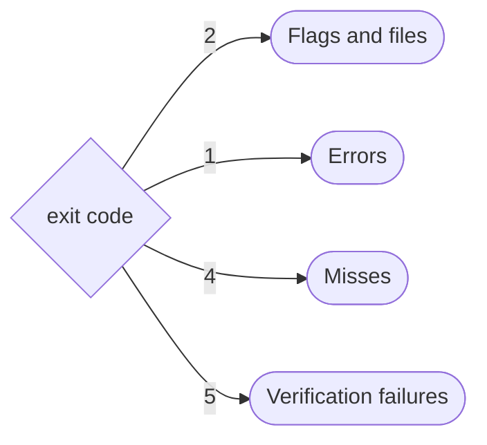

# Troubleshooting

Goal: go from an exit code or an error message to its cause and its fix.
Text in `<...>` changes per run.

## Start with the exit code

--8<-- "docs/cli-reference.md:exit-codes"

## Flags and files (exit 2)

??? failure "Flag errors"
    | Message | Fix |
    |---|---|
    | `--push requires --registry`, `--stats requires --registry`, `--registry is required`, `a run record file is required` | add the flags it names, or set `AVAL_REGISTRY` |
    | `--shadow and --no-reuse exclude each other` | pick one |
    | `registry: must not contain credentials (user:password@) or a digest; registry logins come from the credential store` | drop `user:password@` from the policy's `registry`, use `docker login`, and rotate the password if the file was shared |
    | `--registry <x> is not an OCI repository`, `drop <scheme>://: try --registry <host/name>` | use `host/name`, no `https://`, tag or digest |
    | `--registry-timeout must be positive`, `--output must be text or json`, `--min-trust-level: <x> must be developer, runner or isolated`, `--min-trust-level <x> is below minTrustLevel <y> of the trust policy`, `unknown command`, `unknown flag` | fix the value (the message names the closest command or flag, `did you mean "run"?`; `--min-trust-level` and `AVAL_MIN_TRUST_LEVEL` only raise the policy's minimum); see `aval <command> --help` |
    | `signing needs one of:` | pass `--key` (`aval keygen` makes one), set `SIGSTORE_ID_TOKEN`, or sign on a terminal or with `--login` ([Signing](signing.md)) |
    | `not a PEM file`, `PEM type <x> is encrypted`, `not an ECDSA P-256 key`, `is a public key`, `pass the private key` | make an unencrypted P-256 key ([Signing](signing.md)); for a public key, pass `<name>.key`, not `<name>.pub` |
    | `is already running in an outer aval run` | `runner.command` starts `aval run` on the same contract again, directly or through other contracts: call the test command itself, not the target that wraps it in `aval run` ([Nested runs](../contract.md#nested-runs)) |
    | `holds neither an Aval result nor a report`, `is an input of the test` | write `--result-file` and `--report-file` under `.aval/`; for `output <x> is an input of the test`, exclude it from `scope` |

??? failure "Contract errors"
    | Message | Fix |
    |---|---|
    | `or pass its path with -f` | create `aval.yaml`, or pass `-f path/to/aval.yaml` |
    | `apiVersion: got <x>, want <y>`, `that is the pre-freeze version`, `kind: got <x>, want <y>`, `defaults: <x>`, `fragments.<x>: <x>`, `the name must be 1-64 chars`, `not used by any test`, `use: unknown fragment <x>`, `tests: at least one test is required`, `from <x> conflicts with <y> from <z>`, `matrix: at least one variable is required`, `matrix.<x>: at least one value is required`, `matrix: expands to more than <n> tests in the set`, `the set expands to more than <n> tests`, `unknown matrix variable {<x>} in <y>`, `metadata.name <x> is also the name of tests[<i>]`, `the TestSet holds <n> tests (<x>); select one with --test`, `no test named <x>; its tests: <y>`, `kind: TestSet holds many tests; this place takes one kind: Test` | set `apiVersion: aval.trianalab.io/v1`, `kind: Test` or `kind: TestSet`; for a TestSet follow its rules ([Many tests in one file](../contract.md#many-tests-in-one-file-testset)): keys each block may set, every fragment used, one value per toolchain, probe or `scope.root` key, every `{var}` a matrix variable (`$VAR` for shell variables), unique names, at most 1024 tests; select a test of a set with `--test <name>` ([Select a test](../contract.md#select-a-test)), and `scope.contracts` takes a `kind: Test` |
    | `invalid contract:` with one indented line per problem (`unknown field`, `did you mean <x>?`, `known fields: <x>`, `got <x>, want <y>`), `decoding contract: <x>`, `multiple YAML documents are not allowed` | fix the field at the YAML path the line names (`line 8: scope.sources`; `want a list` means `["go", "test"]`), or the YAML syntax; keep one document |
    | `metadata.name: <x> must be 1-64 chars` | lower case letters, digits, `.`, `_`, `-` |
    | `runner.command: must be a non-empty argv list` | `command: ["go", "test", "./..."]` |
    | `scope.source: at least one glob is required` | list the files the test reads |
    | `empty glob`, `must be a relative, slash-separated path`, `empty, '.' or '..' segments are not allowed`, `'**' must be a whole path segment` | write globs like `src/**/*.go` |
    | `cacheability: required`, `cacheability: unknown class` | pick a [class](write-a-contract.md#step-by-step) |
    | `environment.toolchain: invalid key`, `invalid variable name`, `environment.probe.<key>: not a key of environment.toolchain`, `environment.probe.<key>: must be a non-empty argv list`, `environment.probe.<key>: environment.toolchain.<key> must not be empty`, `is set by aval run and is not an input` | lower case tool names, valid variable names other than `AVAL_RUN_STACK`; probe only declared, non-empty toolchain keys, each with an argv |
    | `scope.allowMutable[<i>]: ref and reason are both required`, `file <x> must be a slash-separated path relative to the contract root`, `file and files exclude each other`, `scope.allowMutable[<i>].files[<j>]: <x>`, `matches no file in scope` | give each entry a `ref`, a `reason` and, if needed, a `file` as the finding prints it or `files` globs (not both) that each match a file in the scope ([Pin your dependencies](../pinning.md#accept-a-reference-on-purpose)) |
    | `scope.resolve[<i>]: <x>`, `unknown kind <x>`, `the reference must be non-empty`, `credentials in the reference are not allowed`, `a scope.resolve entry is one` | one known `kind: reference` per entry, no credentials ([Resolve references](../resolve/index.md)) |
    | `scope.contracts[<i>]: <x>`, `must be slash-separated`, `must be a clean relative path`, `must name a contract file`, `is listed twice`, `scope.root: <x> must be '..' segments only` | a relative path to a `.yaml` contract, listed once ([Depend on another part of the repo](depend-on-a-contract.md)); `root: ..` or `../..` ([Contracts in a subdirectory](../contract.md#contracts-in-a-subdirectory)) |
    | `not a valid <kind> package name`, `is not a registry version, range or tag`, `want group:artifact:version` | use the registry name and a version, range or tag, not a path, file or URL ([Resolve references](../resolve/index.md#exact-or-floating)) |

## Errors (exit 1)

- `aval verify` exits 1.
- `aval run` prints outcome `error`, warns `aval: warning: reuse off: <message>`, runs the test and exits with its code.
- `aval run` exits 1 only when the test cannot start or the result cannot be published. A failed `environment.probe` warns `result not recorded` and follows the test's code; with `--push` it exits 1 (`result not published`).

??? failure "Fingerprint and trust policy"
    | Message | Fix |
    |---|---|
    | `scope.source matched no files`, `glob <x> matched no files` | fix the glob, or create the file |
    | `is excluded only by a trailing` | exclude the file by name |
    | `only regular files are supported in scope`, `control characters in path are not supported` | keep symlinks and odd names out of scope |
    | `scope.contracts <path>: <x>` | fix the referenced contract or the path ([Depend on another part of the repo](depend-on-a-contract.md)) |
    | `resolve <kind> <ref>: <x>` | check name, version, network, credentials ([Resolve references](../resolve/index.md)) |
    | `decoding policy: <x>`, `minTrustLevel: <x> must be developer, runner or isolated`, `identities: at least one is required`, `identities[<i>]: <x>`, `trustLevel: <x> must be developer, runner or isolated` | fix the field ([Write a trust policy](trust-policy.md)) |
    | `publicKey cannot be combined with issuer or subjectRegexp`, `issuer and subjectRegexp are required (or publicKey)` | one kind of signer per identity |
    | `publicKey: <x>`, `publicKey <file>: <x>`, `not a PEM public key`, `larger than <n> bytes`, `subjectRegexp: <x>` | fix the key file or the regexp |
    | `allowedCacheability: non-deterministic results are never reusable`, `allowedCacheability: unknown class` | remove that class |
    | `sigstore trusted root: <x>` | allow network and a writable `$HOME`, or pin `trustedRoot` |

??? failure "Registry, push and record"
    | Message | Fix |
    |---|---|
    | `cannot reach <host> (<cause>); is the registry running?`, `loading registry credentials: <x>`, `resolving <tag>: <x>`, `listing referrers: <x>`, `fetching manifest <x>`, `fetching layer <x>` | check the address (`AVAL_REGISTRY`, `--registry`), that the registry runs, the network and `docker login`; a report's `reason` keeps the raw error |
    | `signing: <x>`, `publishing: <x>`, `pushing manifest: <x>`, `tagging anchor: <x>` | check the token or key, and write access |
    | `more than <n> attestations` | outcome `verification-failed`, exit 5: none was verified, so check who pushed them (it may be a flooding attempt), then delete old results ([cleanup](../artifact-format.md#the-64-candidate-cap-and-cleanup)) |
    | `is not listed among the referrers of` | push again, or use a registry with OCI 1.1 referrers |
    | `running <x>`, `environment.probe <key> <argv>: declared <x>, observed <y>` | install the program `runner.command` starts, or the declared toolchain version ([Probe the toolchain](../contract.md#probe-the-toolchain)) |
    | `FALSE HIT: <x>` (with `--shadow`) | the test reads an input `scope` does not list: [find it](write-a-contract.md#find-undeclared-inputs) |
    | `writing report: <x>`, `result not published: <x>` | fix the `--report-file` path, or the fingerprint error before it |
    | `publishing outputs: <x>`, `more than <n> output files`, `outputs are capped at`, `is not a regular file (symlinks are not published)`, `backslashes and control characters in a path`, `is the contract`, `restoring outputs: <x>` | keep each output a regular file under the caps and narrow the globs; for `restoring outputs`, remove the symlink or directory in the way. The test ran instead ([Restore coverage and reports on reuse](write-a-contract.md#restore-coverage-and-reports-on-reuse)) |
    | `reading the result recorded by 'aval run'`, `run aval run first, or use aval run --push` | run `aval run` first, or publish from the run with `aval run --push` |
    | `recorded result is for test <x>` | an input changed: run the test again |
    | `reading run record: <x>`, `run record <file>: <x>` | pass the file that `--stats-file` wrote |
    | `warning: run record not`, `warning: key <file> (key id <x>) is not in <policy>` | a warning only; check write access, or trust the key's `.pub` in the policy ([Write a trust policy](trust-policy.md)): the result is still published |

## Misses (exit 4)

??? info "Why nothing was reused"
    | Reason | Fix |
    |---|---|
    | `no attestation found for fingerprint` | none: the inputs changed or nobody pushed yet |
    | `reuse off: no trust policy`, `no trust policy configured` (`aval verify`), `reuse off: no registry`, `reuse off: --no-reuse` | set `AVAL_POLICY` or `--policy`, `AVAL_REGISTRY` or `--registry`; drop `--no-reuse` |
    | `cacheability <x> is never reusable`, `is not in allowedCacheability` | by design, or allow the class in the policy |
    | `not reusable under the trust policy`, `signer <x> has trust level <y>, policy requires at least <z>` | raise the signer's `trustLevel` if you trust it |
    | `mutable references in the inputs` | pin each reference the line lists, or acknowledge it with `scope.allowMutable`; for `lists this ref without file:`, add `file:` ([Pin your dependencies](../pinning.md#accept-a-reference-on-purpose)) |
    | `every listed attestation is gone`, `is gone, skipping it` | someone deleted results during the lookup: run again |

## Verification failures (exit 5)

`aval: SECURITY:` comes first (`aval run` repeats it last); `reason:` says
why. Usually a wrong policy, possibly an attacker
([Outcomes](../concepts/outcomes.md#a-verification-failure-is-a-security-event)).
Beside a verified result it shows in `rejected`: the report keeps outcome
`verified`, but nothing is reused and the exit code is 5.

??? danger "Reasons"
    | Reason | Fix |
    |---|---|
    | `signature: <x>`, `signer key id <x> is not in the trust policy`, `it lists no keyless identities`, `is not accepted by the policy` | trust that signer, or find out who pushed |
    | `bundle signs a different envelope`, `no Sigstore bundle stored with the attestation`, `decoding Sigstore bundle`, `bundle does not carry a DSSE envelope`, `envelope: missing or not an in-toto payload`, `decoding statement`, `statement: type <x>`, `predicate: <x>`, `malformed attestation: <x>` | a broken or forged result: delete it |
    | `fingerprint <x>, want <y>`, `test id <x>, want <y>`, `statement subject does not match the predicate subject` | a result that claims other inputs: delete it |
    | `failed verification beside the verified one` | the report says `verified`, but the attestation in `rejected` is bad: its reason is one of these rows |
    | `cacheability <x> is not reusable under the policy`, `cacheability <x>, want <y>`, `tag <x> points at <y>, not the fingerprint anchor` | a lie about the result or the tag: find out who pushed |
    | `outputs: <x>`, `the result carries no outputs, the contract declares outputs`, `is not a declared output of the contract, or is an input`, `matches no output of the result` | the stored outputs do not match the signed list or the contract: a forged result, or the registry deleted the outputs. Find out who pushed, delete the result and push again |
    | `no signature verifier configured`, `expected fingerprint and test id are required` | only from Go: fill in `VerifyOptions` ([Consume from Go](go-consumer.md)) |

## Read next

- [Outcomes](../concepts/outcomes.md)
- [Pin your dependencies](../pinning.md)
