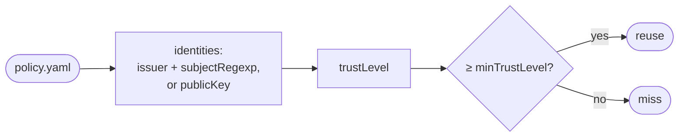

# Write a trust policy

Goal: a `policy.yaml` that says whose results you reuse, and nobody else's.



## The example

Trust one GitHub Actions workflow on `main` (the policy of Aval's
`example-go-compose` job):

```yaml
--8<-- "examples/go-compose/policy.yaml"
```

For a key: [Sign results](signing.md#the-example). Pass it with `--policy`,
or set `AVAL_POLICY` once (the flag wins):

```sh
aval verify --policy policy.yaml
```

## The fields

--8<-- "docs/trust-model.md:policy-fields"

## Tips

- Anchor the subject to one workflow file and one branch. A PR branch runs
  any code: never trust it as `runner`.
- Give developer keys `developer`. Keep `minTrustLevel: runner` in CI, so CI
  never reuses laptop results.
- `subjectRegexp` must match the whole subject. Escape dots: `github\.com`.
- Keyless checks fetch the Sigstore root once; offline the test runs. Pin
  `trustedRoot` to avoid it ([details](../trust-model.md#keyless-verification-needs-the-network-and-a-writable-home)).

## Read next

- [Trust](../concepts/trust.md)
- [Troubleshooting](troubleshooting.md#errors-exit-1): every policy error
