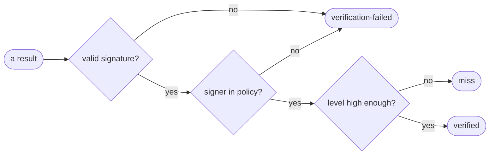

# Write a trust policy

Goal: a `policy.yaml` that says whose results you reuse, and nobody else's.



## The example

=== "Keyless (CI)"

    Trust one GitHub Actions workflow on `main`. This is the policy of the
    `example-go-compose` job in Aval's CI:

    ```yaml
    --8<-- "examples/go-compose/policy.yaml"
    ```

=== "Key"

    Trust one key file. This is the README quickstart, which a test runs:

    --8<-- "README.md:key"

Use it with `--policy`:

```sh
aval verify --registry ghcr.io/acme/orders-aval --policy policy.yaml
```

Without `--policy`, Aval trusts nobody and the test always runs.

## The fields

| Field | What it does |
|---|---|
| `identities` | the signers you accept: an `issuer` plus a `subjectRegexp`, or a `publicKey` file |
| `trustLevel` | how much you trust that signer: `developer`, `runner` or `isolated` |
| `minTrustLevel` | the lowest level you reuse; a signer below it is a miss |
| `allowedCacheability` | optional: add `external-dependencies` to reuse those tests too |
| `trustedRoot` | optional: a pinned Sigstore root, so keyless checks need no network |

## Tips

- Anchor the subject to one workflow file and one branch. A pull request
  branch can run any code, so do not trust it at `runner` level.
- Give developer keys `developer` and keep `minTrustLevel: runner` in CI.
  A laptop policy with `minTrustLevel: developer` then reuses results signed
  with those keys, and CI never does.
- Levels come from the policy only. What a result says about itself is never
  trusted.

??? info "How the subject is matched"
    `subjectRegexp` must match the whole subject, as if it started with `^`
    and ended with `$`. Escape dots: `github\.com`. For GitHub Actions the
    subject is `https://github.com/<owner>/<repo>/<workflow path>@<ref>`.

??? info "Keyless checks and the network"
    A keyless policy fetches the Sigstore trusted root on first use and caches
    it under `$HOME/.sigstore`. Offline, that candidate is an `error` and the
    test runs. Pin the root with `trustedRoot` to avoid this; see
    [the trust model](../trust-model.md#keyless-verification-needs-the-network-and-a-writable-home).

??? info "What Aval rejects"
    Unknown fields, a missing level, no identities, an identity with both
    `publicKey` and `issuer`, and `non-deterministic` in
    `allowedCacheability`. The error names the field; see
    [Troubleshooting](troubleshooting.md#errors-exit-1).

## Read next

- [Trust](../concepts/trust.md): the ideas behind levels
- [Trust model: policy file](../trust-model.md#policy-file)
