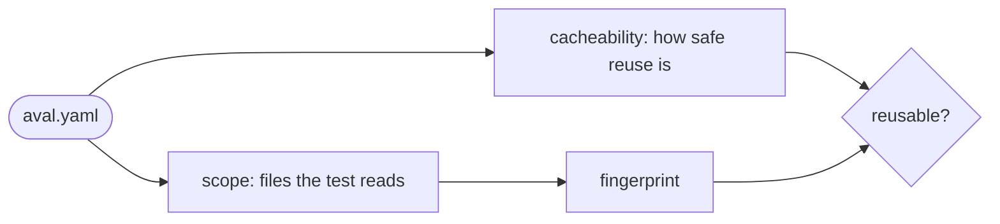

# Write a contract

Goal: an `aval.yaml` that lists every input of your test, so a result is
reused only when none of them changed.



## The example

This contract runs a Go integration test against Redis from Docker Compose.
It is [`examples/go-compose/aval.yaml`](https://github.com/TrianaLab/aval/blob/main/examples/go-compose/aval.yaml),
which CI runs:

```yaml
--8<-- "examples/go-compose/aval.yaml"
```

Put it next to your test and check what it hashes:

```sh
aval run --explain --fingerprint-only
```

## Step by step

1. **Name the test.** `metadata.name` says what is checked. It stays the same
   when the inputs change.
2. **Say how to run it.** `runner.command` is an argv list. Aval does not use
   a shell unless you call one, like the example does.
3. **List the inputs.** `scope.source` lists the files the test reads.
   `scope.dependencies` lists dependency manifests and lockfiles (`go.mod`,
   `go.sum`). Globs are relative to the contract's
   directory; `**` matches any number of directories.
4. **Pick a cacheability class.** It tells Aval and the policy how safe reuse
   is. Tags, ranges and branches block reuse for `hermetic` and
   `controlled-environment`: see
   [Pin your dependencies](../pinning.md).

--8<-- "docs/contract.md:cacheability"

## Check the scope

`--explain` lists every input. Not listed means not hashed: if the test reads
it, add it.

??? example "What `--explain` prints"
    One line per input: kind, sha256, `x` for an executable file, path.

    ```text
    --8<-- "internal/fingerprint/testdata/golden/aval-fingerprint-v1.manifest:1:26"
    ```

??? info "Globs that match nothing"
    Every glob in `source` and `dependencies` must match at least one file.
    Otherwise Aval cannot fingerprint, and the test always runs. `exclude`
    globs may match nothing.

??? info "Environment"
    The `environment.toolchain` values (`go: "1.25"`) go into the fingerprint
    as written; Aval does not check what is installed. `environment.env`
    names variables whose values go into the fingerprint.

## Find undeclared inputs

A file the test reads but `scope` does not list is a false hit waiting to
happen: change it and Aval still reuses the old result. `--shadow` catches
it only after it flips a result ([Measure reuse](measure-reuse.md)). Find
it first: compare the files the test opens with `--explain`.

Example: a pytest contract lists `src/**` and `tests/unit/**`, but pytest
also loads `tests/conftest.py`. On Linux, from the contract's directory:

```sh
strace -f -e trace=openat -o trace.txt pytest tests/unit
grep -v ENOENT trace.txt | grep -o '"[^"]*"' | tr -d '"' | sed "s|^$PWD/||" \
  | grep -v '^/' | sort -u > read.txt
aval run --explain --fingerprint-only | awk '$1 == "source" || $1 == "dependency"' \
  | cut -d' ' -f4- | sort -u > scope.txt
comm -23 read.txt scope.txt
```

```text
tests/conftest.py
```

Add `tests/conftest.py` to `scope.source`. Some lines are directories or
caches (`__pycache__`): read the list, do not paste it into the contract.
Files hashed by contracts in `scope.contracts` are not in this list; check
those contracts the same way.

??? info "macOS and Windows"
    - macOS: while the test runs, `sudo fs_usage -w -f pathname <process
      name>` lists the paths it opens.
    - Windows: Process Monitor, filtered on the test's process and on
      `Path begins with` the contract's directory.

??? info "Without a tracer"
    Copy only the scope to an empty directory and run the test there. A
    missing input usually fails the run or changes its result:

    ```sh
    scope=$(mktemp -d)
    aval run --explain --fingerprint-only | awk '$1 == "source" || $1 == "dependency"' \
      | cut -d' ' -f4- | tar -cf - -T - | tar -xf - -C "$scope"
    (cd "$scope" && pytest tests/unit)
    ```

Aval does not trace tests: that needs per-OS code and often root, and
would infer scope ([future work](../contract.md#future-work)).

## Read next

- [Write a trust policy](trust-policy.md)
- [Pin your dependencies](../pinning.md)
- [The test contract](../contract.md): every field and rule
