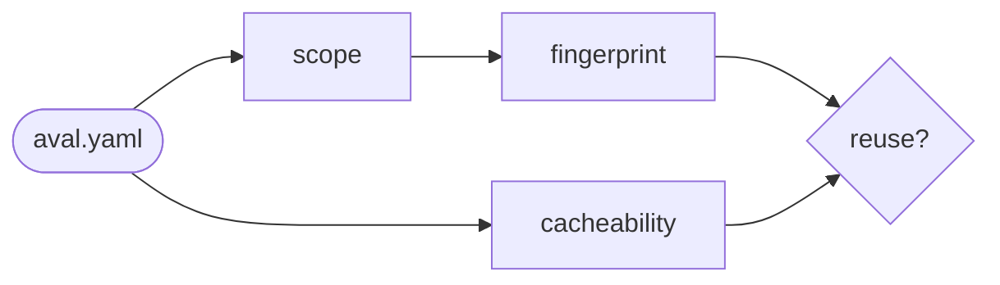

# Write a contract

Goal: an `aval.yaml` that lists every input of your test, so a result is
reused only when none of them changed.



## The example

A Go test against Redis from Docker Compose,
[`examples/go-compose/aval.yaml`](https://github.com/TrianaLab/aval/blob/main/examples/go-compose/aval.yaml):

```yaml
--8<-- "examples/go-compose/aval.yaml"
```

`aval init` writes a first one ([Quickstart](../quickstart.md)).

## Step by step

1. **Name the test.** `metadata.name` says what is checked. It does not
   change when inputs do.
2. **Say how to run it.** `runner.command` is an argv list. No shell unless
   you call one.
3. **List the inputs.** `scope.source` for files the test reads,
   `scope.dependencies` for manifests and lockfiles. Globs are relative to the
   contract; `**` is any depth. A glob that matches nothing means no
   fingerprint: the test always runs (`exclude` globs may match nothing).
4. **Pick a cacheability class.** How safe reuse is. Tags and ranges block
   reuse for `hermetic` and `controlled-environment`: [pin them](../pinning.md).

--8<-- "docs/contract.md:cacheability"

## Check the scope

```sh
aval explain
```

It prints one line per input: kind, sha256, `x` if executable, path. Not
listed means not hashed.

## Restore coverage and reports on reuse

A reused result writes no coverage file. List the files later steps read
under `outputs`, e.g. `outputs: [coverage.xml, junit.xml]`:

- `aval run --push` and `aval push` publish them, signed. `aval push` reads
  them from disk: push right after `aval run`.
- `aval run` writes them back after a result verifies. `aval verify` writes nothing.

!!! warning "Outputs are published"
    Anyone who can read the registry can read them. On reuse Aval writes any
    file a trusted signer published under the globs, except the contract and
    its inputs. List no secrets and keep the globs narrow: `**` can overwrite
    files later steps read. Caps: [`outputs`](../contract.md#fields).

## Find undeclared inputs

A file the test reads but `scope` misses is a false hit waiting to happen.
On Linux, compare what the test opens with `aval explain`:

```sh
strace -f -e trace=openat -o trace.txt pytest tests/unit
grep -v ENOENT trace.txt | grep -o '"[^"]*"' | tr -d '"' | sed "s|^$PWD/||" \
  | grep -v '^/' | sort -u > read.txt
aval explain | awk '$1 == "source" || $1 == "dependency"' \
  | cut -d' ' -f4- | sort -u > scope.txt
comm -23 read.txt scope.txt   # prints tests/conftest.py
```

Read the list, do not paste it: some lines are caches. On macOS use
`sudo fs_usage -w -f pathname <process>`, on Windows Process Monitor.
Anywhere: copy only the scope to an empty directory and run the test there.

## Read next

- [Shards and matrices](shards-and-matrices.md)
- [Write a trust policy](trust-policy.md)
- [The test contract](../contract.md): every field and rule
