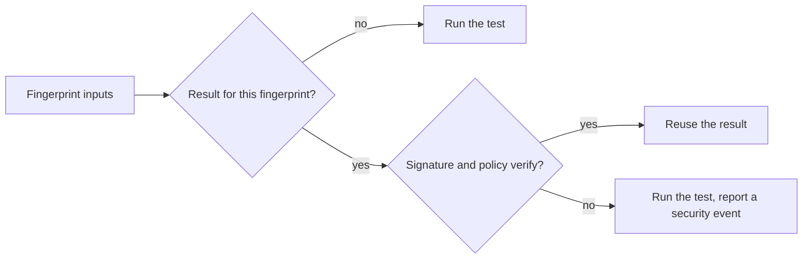

---
# The hero (headline, kicker, buttons) lives in overrides/home.html. The hidden
# h1 below repeats its headline so Material does not inject a "Home" h1.
template: home.html
---

# Run a heavy test once. Reuse the result safely everywhere. { hidden=hidden }

## How it works { #how-it-works }

A heavy test runs once. Aval signs the result and binds it to a fingerprint of the test's declared inputs. Another pipeline with the same fingerprint verifies the signature against its trust policy and skips the run.

!!! note "Fail closed"
    If Aval cannot prove the inputs are the same, or cannot verify who signed the result, the test runs.

## Where to start

- [Why Aval](vision.md): the problem, the goals and the roadmap.
- [Trust model](trust-model.md): what a signature proves and how policy decides.
- [The test contract](contract.md): the `aval.yaml` file and what goes into the fingerprint.
- [CLI reference](cli-reference.md): every command and flag.
