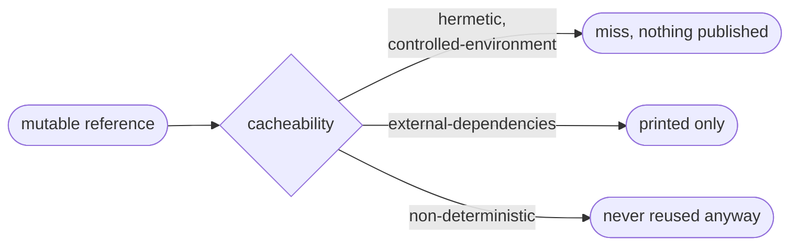

# Pin your dependencies

Goal: no input that can change behind the same name.



Aval hashes the text `postgres:16`, not the image behind it. A repushed tag
would not change the fingerprint, so Aval reports it and does not reuse:

```text
mutable: compose.yaml:3 (container) postgres:16: a tag can be repushed: pin the image by digest (name:tag@sha256:...)
```

- The line names file:line, ecosystem, the reference and the fix.
- `aval verify` exits 4; `aval run --push` and `aval push` publish nothing.
- `aval explain` prints it on stderr.
- The scan reads files only. It never fetches or runs anything.

## Fix it by ecosystem

| Ecosystem | Commit and add to `scope.dependencies` | In files and commands, pin |
|---|---|---|
| Go | `go.sum` | `go install x@v0.30.0`, not `@latest` or `@main` |
| JavaScript | a lockfile (`package-lock.json`, `npm-shrinkwrap.json`, `yarn.lock`, `pnpm-lock.yaml`, `bun.lock` or `bun.lockb`); without one every range is reported | `npm ci`, `npx --yes prettier@3.3.3` |
| Python | requirements with `==` (better with hashes), or `poetry.lock`, `Pipfile.lock`, `uv.lock`, `pdm.lock` | git requirements `@<40-hex>`; files named by `-r`/`-c` must be in scope |
| Rust | `Cargo.lock` (workspace root) | `cargo install tool --version 1.2.3` |
| Maven, Gradle | | no `SNAPSHOT`, `LATEST`, `RELEASE`, `1.+`, `latest.release` or ranges in `pom.xml`, `build.gradle(.kts)`, `*.versions.toml` |
| Ruby, PHP | `Gemfile.lock` (or `gems.locked`), `composer.lock` | `gem install tool --version 1.2.3` |
| OS packages | | `apt-get install curl=8.5.0-2`, `apk add jq=1.7.1-r0`, `dnf`/`yum`/`microdnf install curl-7.76.1-26.el9`, `zypper install vim=9.0`, or bake them into an image pinned by digest |
| Helm | | `helm install`/`upgrade --version 1.2.3` for a chart outside the scope; a chart in the scope is checked as files |
| Git | | `git clone URL && git -C dir checkout <40-hex>`, one checkout per clone; no `git pull`, no submodule `branch =` or `update --remote` |

Python details: [Python](mutable-references.md#python).

### Container images

Pin every image by digest. Keep the tag for readers; the digest decides.

```yaml
# compose.yaml, Kubernetes manifests, rendered Helm charts
image: redis:7.4-alpine@sha256:c5d34a98396a4775e223c74e929162c35c5a2182901ba26b50ade939941ce14b
```

```dockerfile
# syntax=docker/dockerfile:1@sha256:<digest>
FROM golang:1.25@sha256:<digest> AS build
FROM build AS test          # a stage name is fine
COPY --from=nginx:1.27@sha256:<digest> /etc/nginx /etc/nginx
ADD --checksum=sha256:<sum> https://example.com/tool.tgz /tool.tgz
```

Find the digest with `crane digest <image:tag>`. Testcontainers, Dockerfiles,
Kustomize and YAML rules: [Container images](mutable-references.md#container-images).

### Scripts from the network

`curl … | sh`, `eval "$(curl …)"` and `releases/latest` URLs run whatever the
server sends. Vendor the script into the scope, or download a fixed version
and check its sha256. [All variants and which files are scanned](mutable-references.md#scripts).

## Resolve a reference instead

To follow a tag on purpose, declare it in `scope.resolve`
([Resolve references](resolve/index.md)). The fingerprint then changes when
the target moves; the scan still reports it, so pin or accept it.

## Accept a reference on purpose

Such as an image your team rebuilds and scans every night. Say why in the
contract:

```yaml
apiVersion: aval.trianalab.io/v1
kind: Test
metadata:
  name: orders-integration
runner:
  command: ["docker", "compose", "run", "--rm", "tests"]
scope:
  source: ["**/*.go", "compose.yaml"]
  allowMutable:
    - ref: postgres:16          # exactly as Aval prints it
      reason: rebuilt and scanned nightly; the tag is ours
    - file: deploy/kustomization.yaml   # only the finding in this file
      ref: resources[0]
      reason: vendored upstream base, reviewed on update
cacheability: controlled-environment
```

- `ref` is the text Aval prints; `file` limits the entry to one file.
- It changes the fingerprint and shows in review.
- `aval run` still prints the finding, marked `(allowed: <reason>)`.

Fine print: [`scope.allowMutable`](mutable-references.md#scopeallowmutable).
The scan is a safety net, not a guarantee: [Limits](mutable-references.md#limits).

## Read next

- [Resolve references](resolve/index.md)
- [Write a contract](guides/write-a-contract.md)
