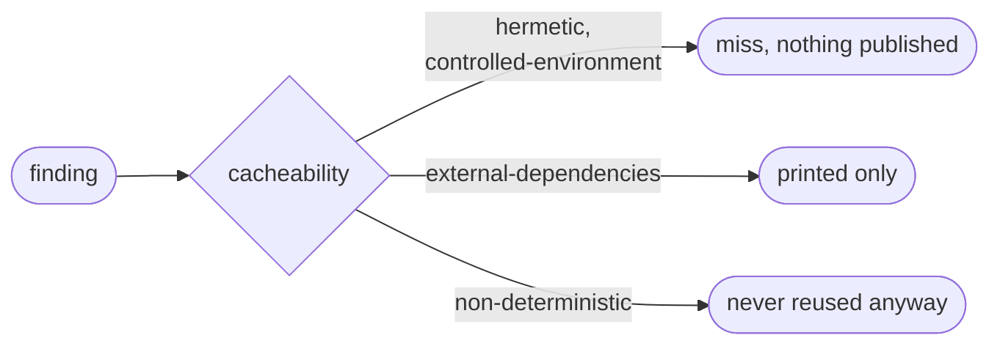

# Pin your dependencies

Goal: no input that can change behind the same name.

Aval hashes the text `postgres:16`, not the image behind it, so a repushed tag
would not change the fingerprint. Aval reports such **mutable** references, in
the scope and in `runner.command`, and does not reuse a result that depends on
one:

```text
mutable: compose.yaml:3 (container) postgres:16: a tag can be repushed: pin the image by digest (name:tag@sha256:...)
```

The fix is the immutable id in the file:

```yaml
image: redis:7.4-alpine@sha256:c5d34a98396a4775e223c74e929162c35c5a2182901ba26b50ade939941ce14b
```



`aval verify` exits 4; `aval run --push` and `aval push` publish nothing. The
line names file:line, ecosystem, the reference and the fix.
`--fingerprint-only` prints it on stderr.

??? info "How the scan works"
    - It reads files only; it never fetches, resolves or runs anything.
    - At most 1 MiB per file. A bigger or unreadable file it should check is a
      `scan` finding that cannot be accepted: shrink or split it.
    - Lockfiles (`pnpm-lock.yaml`, `go.sum`, `Cargo.lock`, ...) are hashed,
      not scanned.

## Fix it by ecosystem

| Ecosystem | Commit and add to `scope.dependencies` | In files and commands, pin |
|---|---|---|
| Go | `go.sum` | `go install x@v0.30.0`, not `@latest` or `@main` |
| JavaScript | a lockfile (`package-lock.json`, `npm-shrinkwrap.json`, `yarn.lock`, `pnpm-lock.yaml`, `bun.lock` or `bun.lockb`); without one every range is reported | `npm ci`, `npx --yes prettier@3.3.3` |
| Python | requirements with `==` (better with hashes), or `poetry.lock`, `Pipfile.lock`, `uv.lock`, `pdm.lock` | git requirements `@<40-hex>`; files named by `-r`/`-c` must be in scope |
| Rust | `Cargo.lock` (workspace root) | `cargo install tool --version 1.2.3` |
| Maven, Gradle | | no `SNAPSHOT`, `LATEST`, `RELEASE`, `1.+`, `latest.release` or ranges in `pom.xml`, `build.gradle(.kts)`, `*.versions.toml` |
| Ruby, PHP | `Gemfile.lock` (or `gems.locked`), `composer.lock` | `gem install tool --version 1.2.3` |
| OS packages | | `apt-get install curl=8.5.0-2`, `apk add jq=1.7.1-r0`, `dnf`/`yum`/`microdnf install curl-7.76.1-26.el9`, `zypper install vim=9.0`, or bake them into an image pinned by digest |
| Helm | | `helm install`/`upgrade --version 1.2.3` for a chart outside the scope; a chart in the scope is checked as files |
| Git | | `git clone URL && git -C dir checkout <40-hex>`, one checkout per clone; no `git pull`, no submodule `branch =` or `update --remote` |

??? info "Python details"
    - Generate the file: `uv pip compile --generate-hashes requirements.in -o
      requirements.txt`, then `pip install --require-hashes -r
      requirements.txt`.
    - Once one entry of a requirements file has a hash, every entry needs one.
    - Any `requirements*.txt` path is checked, also `requirements/dev.txt`.
    - Poetry needs `poetry.lock` and Pipenv `Pipfile.lock` next to the
      manifest. A `pyproject.toml` with `[project]` dependencies needs
      `uv.lock`, `pdm.lock` or `poetry.lock`, next to it or at the workspace
      root.
    - A file named by `pip install -r`/`-c`, or by an include line inside a
      requirements file (resolved next to that file), must be in the scope,
      or it is reported.

### Container images

Pin every image by digest. Keep the tag for readers; the digest decides.

```yaml
# compose.yaml, Kubernetes manifests, rendered Helm charts
image: redis:7.4-alpine@sha256:c5d34a98396a4775e223c74e929162c35c5a2182901ba26b50ade939941ce14b
```

```dockerfile
# syntax=docker/dockerfile:1@sha256:<digest>
FROM golang:1.25@sha256:<digest> AS build
FROM build AS test          # a stage name is fine
COPY --from=nginx:1.27@sha256:<digest> /etc/nginx /etc/nginx
ADD --checksum=sha256:<sum> https://example.com/tool.tgz /tool.tgz
```

Find the digest with `crane digest <image:tag>` or
`docker buildx imagetools inspect <image:tag>`.

??? info "What else is checked"
    - Images in `docker run`, `podman run`, `docker compose` and
      `kubectl run`/`create --image` commands. A compose file the command uses
      must be in `scope.source`; it can be YAML or JSON (`compose.json`).
    - An image from a variable Aval cannot resolve (`${DB_IMAGE}`), a Helm
      template (`{{ .Values.image }}`), a YAML alias, block scalar or tag
      (`image: *img`, `image: >-`, `image: !!str ...`) is reported: write the
      reference inline, or render the chart into the scope.
    - **Dockerfiles** are read twice. The line pass reads each line as an
      instruction (continuations joined with a space, `RUN` heredocs as
      scripts). The BuildKit pass splits the file as BuildKit does, for files
      named `Dockerfile`, `Dockerfile.*`, `*.dockerfile`, `Dockerfile` plus a
      name without a dot (`Dockerfile-dev`), and the same with
      `Containerfile`: comment lines stand alone, continuations join with
      nothing between (`FROM db:1\` then `6` is `db:16`), `# escape=` sets the
      escape character (continuations and heredoc words), heredoc bodies are
      kept apart.
    - Both passes treat `COPY --from=` and `RUN --mount=...,from=` like a
      `FROM`: a stage name or index is fine, an image needs a digest. An
      instruction behind `ONBUILD` is checked like the same one without it.
    - The BuildKit pass also reports a file BuildKit refuses (an invalid
      `# escape=`, a repeated directive, an unterminated heredoc), a heredoc
      name with a quote, `\` or `$`, or an empty one, and a `FROM` image with a
      variable that is not a global `ARG` with a value (`FROM alpine:$V`):
      give the global `ARG` a default, or write the image.
    - **Kustomize**: an `images:` (or `imageTags:`) entry with `newName` or
      `newTag` needs a `digest:`. Reported by name and index
      (`resources[2]`): a remote or out-of-scope `resources`, `components` or
      `bases` entry (vendor it); a patch or `replacements` entry that sets an
      image, or is given by an out-of-scope path; a `transformers` or
      `generators` entry with an image transformer or an out-of-scope path; a
      `helmCharts` entry, unless the chart is local (no `repo`, `Chart.yaml` in
      the scope under `helmGlobals.chartHome`, default `charts`, inside the
      kustomization directory) and no `valuesInline` sets an image; any
      `tagSuffix` (kustomize drops the digest). An undecodable kustomization
      is reported by its path. The overlay is not built.
    - **YAML** is read twice: the line pass matches `image:` on every line,
      also inside a block scalar a template renders; the parser matches every
      key that decodes to `image` (`"ima\x67e":`, `? image`, `!!binary
      aW1hZ2U=:`). A key with another tag, or one the parser cannot decode in
      a file it rejects, is reported; in `*.tpl` files, files under
      `templates/` and rejected files, a key a template writes
      (`ima{{ "ge" }}:`) is reported by its text, except a `range` key
      variable alone (`{{ $key | quote }}:`) directly under `labels:` or
      `annotations:`. A Compose
      `build.dockerfile_inline` is checked as a Dockerfile, and
      `build.additional_contexts` values with `docker-image://` as images.
    - **JSON** is read the same way, but only in Compose files, files under
      `templates/` and files a kustomization in scope lists in `resources`.

### Scripts from the network

`curl … | sh` (also through `tee`), `bash -c "$(curl …)"`,
`python -c "$(curl …)"`, `eval "$(curl …)"`, `source <(wget …)` and
`releases/latest` URLs run or fetch whatever the server sends, also in
Dockerfile `RUN` lines and heredocs. Vendor the script into the
scope, or download a fixed version and check its sha256 before running it.

??? info "Which files are scanned as scripts"
    `*.sh`, `*.bash`, `*.zsh`, `*.mk`, `Makefile`, and in-scope files without
    an extension whose first line is a `sh`, `bash`, `zsh`, `ksh` or `dash`
    shebang (`./setup`). A script with another extension is hashed but not
    scanned.

## Resolve a reference instead

To follow a tag or branch on purpose, declare it in `scope.resolve`
([Resolve references](resolve/index.md)). That changes the fingerprint when
the target moves, but the scanner still reports the reference: pin it or
accept it below.

## Accept a reference on purpose

Sometimes a mutable reference is acceptable, for example an image your team
rebuilds and scans every night. Acknowledge it in the contract, with the
reason:

```yaml
apiVersion: aval.trianalab.io/v1
kind: Test
metadata:
  name: orders-integration
runner:
  command: ["docker", "compose", "run", "--rm", "tests"]
scope:
  source: ["**/*.go", "compose.yaml"]
  allowMutable:
    - ref: postgres:16          # exactly as Aval prints it
      reason: rebuilt and scanned nightly; the tag is ours
    - file: deploy/kustomization.yaml   # only the finding in this file
      ref: resources[0]
      reason: vendored upstream base, reviewed on update
cacheability: controlled-environment
```

- `ref` is the text Aval prints: for a missing lockfile, the manifest path
  (`go.mod`); quotes in shell commands are dropped. A finding Aval reports
  because it cannot tell (a templated key, `resources[2]`, a heredoc name, a
  `FROM` line) is in the `container` ecosystem, accepted by its printed `ref`.
- `file` is the path Aval prints before the line number, relative to the
  contract (`runner.command` for the command), and limits the entry to that
  file. Without it, a `ref` that two files report (`resources[0]` repeats) is
  not accepted, and the finding asks for `file`. With
  [`scope.contracts`](guides/depend-on-a-contract.md), each contract's entries
  apply to its own findings.
- It is part of the contract, so it changes the fingerprint and shows in
  review.
- `aval run` still prints the finding, marked `(allowed: <reason>)`.

??? warning "Limits"
    The scanner reads text and is a safety net, not a guarantee; the
    guarantee is the declared scope and the pins you write.

    - Not detected: unversioned downloads other than `releases/latest`
      (`curl -o tool URL`, `curl URL | tar x`); Helm values split into
      `repository` and `tag`, or YAML a template prints; a JSON6902 patch file
      in the scope named by `path:`; JSON outside the files above; `--build-arg` values
      (the `ARG` default is checked; outside `FROM` the last value of a name
      wins); the BuildKit pass on a source file named like
      `dockerfile_test.go`.
    - Shell commands are split without a full parser: a quoted `;` or `>`
      also splits, which can cause needless misses.
    - An option Aval does not know to take a value
      (`tool --opt value install x`) hides the subcommand.
    - For the gaps, declare the reference in `scope.resolve`
      ([`url`](resolve/urls.md), [`image`](resolve/images.md)) and run
      `aval run --shadow`.

## Read next

- [Resolve references](resolve/index.md)
- [Write a contract](guides/write-a-contract.md)
- [Measure reuse](guides/measure-reuse.md)
