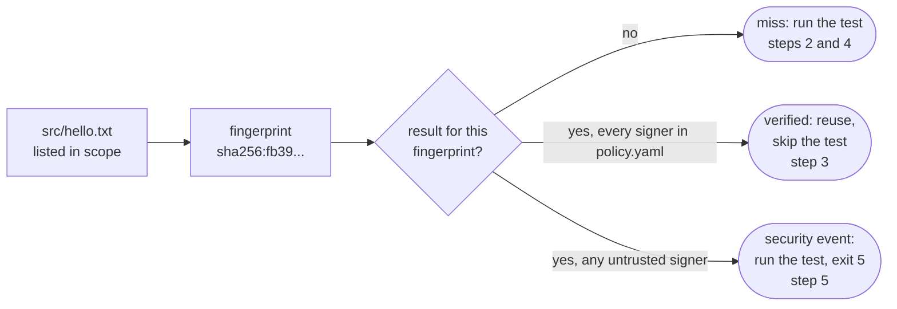

# Quickstart

What does Aval do? See it in five minutes on your laptop: a miss, a reuse,
a changed input and a rejected result.

You need `aval` ([Install](install.md)) and Docker. Run the blocks in order
in one shell. `text` blocks show the output; `...` changes per run.

<!-- quickstart:start (tests/acceptance/readme_test.go runs the sh blocks and checks the text blocks) -->

## 1. Set up

Start a local registry on port 5001 (macOS keeps 5000 for AirPlay):

```sh
docker rm -f aval-registry 2>/dev/null || true
docker run -d --name aval-registry -p 5001:5000 registry:2
```

Make a project with one input file. `aval init` writes:

- `aval.yaml`: the test command and the files it reads (`scope`);
- a signing key;
- `policy.yaml`: a trust policy that trusts that key.

You declare what the test reads (`--source`); Aval never guesses:

```sh
rm -rf aval-demo && mkdir aval-demo && cd aval-demo
mkdir src && echo hello > src/hello.txt
aval init --name hello --source 'src/**' --cacheability hermetic --key aval.key -- grep -q hello src/hello.txt
```

```text
source matches 1 file: src/hello.txt
wrote aval.key (private: keep it secret, do not commit it) and aval.pub, key id ...
wrote policy.yaml: trusts aval.pub at trust level developer
wrote aval.yaml
added aval.key, .aval/ to .gitignore
next: export AVAL_REGISTRY=<oci repository> AVAL_POLICY=policy.yaml, then aval run --push --key aval.key
```

Without flags, `aval init` asks for each value. Now set the registry and the
policy once for this shell:

```sh
export AVAL_REGISTRY=localhost:5001/demo/hello-aval AVAL_POLICY=policy.yaml
```

## 2. First run: a miss


Nothing is stored for these inputs yet: the test runs, then `--push` signs
the result and stores it:

```sh
aval run --push --key aval.key
```

This is the plain output, as in CI. A terminal shows glyph lines instead.

```text
config: registry=localhost:5001/demo/hello-aval (env AVAL_REGISTRY) policy=policy.yaml (env AVAL_POLICY)
miss hello sha256:640f5db75fa5b71422b1afaffb4c645194aaccb223dae9070968e375bccbaf42
reason: localhost:5001/demo/hello-aval: no attestation found for fingerprint
--- run hello: grep -q hello src/hello.txt
--- end hello: passed (exit 0) in ...
ran hello: passed (exit 0)
pushed localhost:5001/demo/hello-aval@sha256:...
summary: hello ran: passed in ...; result pushed
```

## 3. Second run: a reuse


Is there a trusted result for these inputs?

```sh
aval verify
echo "exit code: $?"
```

```text
config: registry=localhost:5001/demo/hello-aval (env AVAL_REGISTRY) policy=policy.yaml (env AVAL_POLICY)
verified hello sha256:640f5db75fa5b71422b1afaffb4c645194aaccb223dae9070968e375bccbaf42
signer: key ..., trust level developer
reference: localhost:5001/demo/hello-aval@sha256:...
exit code: 0
```

Run again. The test is skipped:

```sh
aval run
```

```text
config: registry=localhost:5001/demo/hello-aval (env AVAL_REGISTRY) policy=policy.yaml (env AVAL_POLICY)
verified hello sha256:640f5db75fa5b71422b1afaffb4c645194aaccb223dae9070968e375bccbaf42
signer: key ..., trust level developer
reference: localhost:5001/demo/hello-aval@sha256:...
reused passed result
summary: hello reused: passed; saved ...
```

## 4. Change an input: a miss again


Edit a file in `scope`. New fingerprint, nothing matches, the test runs:

```sh
echo "hello, world" > src/hello.txt
aval run
```

```text
config: registry=localhost:5001/demo/hello-aval (env AVAL_REGISTRY) policy=policy.yaml (env AVAL_POLICY)
miss hello sha256:944c02c002bb6830480c64e44594d52265970351501f2372947e054795c37fc0
reason: localhost:5001/demo/hello-aval: no attestation found for fingerprint
--- run hello: grep -q hello src/hello.txt
--- end hello: passed (exit 0) in ...
ran hello: passed (exit 0)
summary: hello ran: passed in ...
```

## 5. A result from an untrusted signer: exit 5


Someone pushes a result signed with a key your policy does not trust
(`AVAL_POLICY=` drops your policy for that one push). Aval rejects it, runs
the test and exits 5: a security event, not a miss.

```sh
aval keygen other
AVAL_POLICY= aval run --push --key other.key
aval run
echo "exit code: $?"
```

```text
wrote other.key (private: keep it secret, do not commit it) and other.pub
key id: ...
next: trust other.pub in your policy (publicKey: other.pub) and sign with --key other.key
config: registry=localhost:5001/demo/hello-aval (env AVAL_REGISTRY)
miss hello sha256:944c02c002bb6830480c64e44594d52265970351501f2372947e054795c37fc0
reason: reuse off: no trust policy (set AVAL_POLICY or --policy)
--- run hello: grep -q hello src/hello.txt
--- end hello: passed (exit 0) in ...
ran hello: passed (exit 0)
pushed localhost:5001/demo/hello-aval@sha256:...
summary: hello ran: passed in ...; result pushed; reuse was off
config: registry=localhost:5001/demo/hello-aval (env AVAL_REGISTRY) policy=policy.yaml (env AVAL_POLICY)
aval: SECURITY: 1 attestation(s) for hello failed signature or policy verification; treat it as a security event, see https://aval.run/.../trust-model/
verification-failed hello sha256:944c02c002bb6830480c64e44594d52265970351501f2372947e054795c37fc0
reference: localhost:5001/demo/hello-aval@sha256:...
reason: attestation verification failed: signature: signer key id "..." is not in the trust policy (trust policy policy.yaml)
--- run hello: grep -q hello src/hello.txt
--- end hello: passed (exit 0) in ...
ran hello: passed (exit 0)
summary: hello ran: passed in ...; SECURITY
aval: SECURITY: 1 attestation(s) for hello failed signature or policy verification; treat it as a security event, see https://aval.run/.../trust-model/
exit code: 5
```

<!-- quickstart:end -->

## What just happened



Stop the registry:

```sh
docker rm -f aval-registry
```

Next: [write a contract](guides/write-a-contract.md), then
[use GitHub Actions](guides/github-actions.md).
