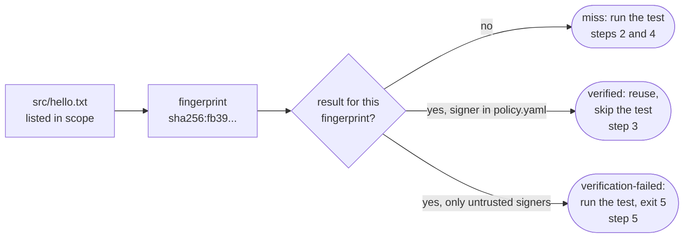

# Quickstart

On your laptop, in five minutes: a miss, a reuse, a changed input and a
rejected result.

You need `aval` ([Install](install.md)) and Docker. Run the blocks
in order in one shell. Each `text` block is the expected output; `...` is a
digest that changes on every run.

<!-- quickstart:start (tests/acceptance/readme_test.go runs the sh blocks and checks the text blocks) -->

## 1. Set up

A local OCI registry (port 5001: macOS uses 5000 for AirPlay):

```sh
docker run -d --name aval-registry -p 5001:5000 registry:2
```

A project with one input file. `aval init` writes `aval.yaml`, which names
the test command and the files it reads (`scope`), a signing key (ECDSA
P-256) and `policy.yaml`, a trust policy that trusts the key. `--source` and
`--cacheability` have no default: you declare what the test reads, and init
lists the files it matches:

```sh
mkdir aval-demo && cd aval-demo
mkdir src && echo hello > src/hello.txt
aval init --name hello --source 'src/**' --cacheability hermetic --key aval.key -- grep -q hello src/hello.txt
```

```text
source matches 1 file: src/hello.txt
wrote aval.key (private: keep it secret, do not commit it) and aval.pub, key id ...
wrote policy.yaml: trusts aval.pub at trust level developer
wrote aval.yaml
added aval.key, .aval/ to .gitignore
next: export AVAL_REGISTRY=<oci repository> AVAL_POLICY=policy.yaml, then aval run --push --key aval.key
```

On a terminal, `aval init` without flags asks for each value.

## 2. First run: a miss


This run has no `--policy`, so Aval does not look for a result. It runs the
test, then `--push` signs the result with `aval.key` and pushes it:

<!-- --8<-- [start:push] -->
```sh
aval run --push --key aval.key --registry localhost:5001/demo/hello-aval
```
<!-- --8<-- [end:push] -->

These transcripts are the plain form printed in CI or with `--plain`; on a
terminal the same steps show as glyph lines.

```text
miss hello sha256:fb3906f246f9255cf129e24de1256ac47b85e33cc548f3f517e94e237db0de06
reason: reuse off: no trust policy (set AVAL_POLICY or --policy)
--- run hello: grep -q hello src/hello.txt
--- end hello: passed (exit 0) in ...
ran hello: passed (exit 0)
pushed localhost:5001/demo/hello-aval@sha256:...
summary: hello ran: passed in ...; result pushed; reuse was off
```

## 3. Second run: a reuse


Check that a result you trust exists for these exact inputs:

```sh
aval verify --registry localhost:5001/demo/hello-aval --policy policy.yaml
echo "exit code: $?"
```

```text
verified hello sha256:fb3906f246f9255cf129e24de1256ac47b85e33cc548f3f517e94e237db0de06
signer: key ..., trust level developer
reference: localhost:5001/demo/hello-aval@sha256:...
exit code: 0
```

Run again. Aval finds the trusted result and skips the test:

```sh
aval run --registry localhost:5001/demo/hello-aval --policy policy.yaml
```

```text
verified hello sha256:fb3906f246f9255cf129e24de1256ac47b85e33cc548f3f517e94e237db0de06
signer: key ..., trust level developer
reference: localhost:5001/demo/hello-aval@sha256:...
reused passed result
summary: hello reused: passed; saved ...
```

The flags can come from the environment instead: `AVAL_REGISTRY` and
`AVAL_POLICY`. Export them once to stop repeating them. A flag still wins
over the variable, and the run prints a `config:` line naming each value
that came from the environment:

```sh
AVAL_REGISTRY=localhost:5001/demo/hello-aval AVAL_POLICY=policy.yaml aval run
```

```text
config: registry=localhost:5001/demo/hello-aval (env AVAL_REGISTRY) policy=policy.yaml (env AVAL_POLICY)
verified hello sha256:fb3906f246f9255cf129e24de1256ac47b85e33cc548f3f517e94e237db0de06
signer: key ..., trust level developer
reference: localhost:5001/demo/hello-aval@sha256:...
reused passed result
summary: hello reused: passed; saved ...
```

## 4. Change an input: a miss again


Edit a file in `scope`. The fingerprint changes, so nothing matches and the
test runs:

```sh
echo "hello, world" > src/hello.txt
aval run --registry localhost:5001/demo/hello-aval --policy policy.yaml
```

```text
miss hello sha256:d52167b48089d3c3add62a6e81c6bfb0aa8d90baa98a69235c48bd892297170b
reason: localhost:5001/demo/hello-aval: no attestation found for fingerprint
--- run hello: grep -q hello src/hello.txt
--- end hello: passed (exit 0) in ...
ran hello: passed (exit 0)
summary: hello ran: passed in ...
```

## 5. A result from an untrusted signer: exit 5


Someone who can push to the registry, but with a key your policy does not
trust, publishes a result. Aval rejects it, runs the test and exits 5: a
security event, not a miss. A tampered result ends the same way:

```sh
aval keygen other
aval run --push --key other.key --registry localhost:5001/demo/hello-aval
aval run --registry localhost:5001/demo/hello-aval --policy policy.yaml
echo "exit code: $?"
```

```text
wrote other.key (private: keep it secret, do not commit it) and other.pub
key id: ...
next: trust other.pub in your policy (publicKey: other.pub) and sign with --key other.key
miss hello sha256:d52167b48089d3c3add62a6e81c6bfb0aa8d90baa98a69235c48bd892297170b
reason: reuse off: no trust policy (set AVAL_POLICY or --policy)
--- run hello: grep -q hello src/hello.txt
--- end hello: passed (exit 0) in ...
ran hello: passed (exit 0)
pushed localhost:5001/demo/hello-aval@sha256:...
summary: hello ran: passed in ...; result pushed; reuse was off
aval: SECURITY: 1 attestation(s) for hello failed signature or policy verification; treat it as a security event, see https://aval.run/.../trust-model/
verification-failed hello sha256:d52167b48089d3c3add62a6e81c6bfb0aa8d90baa98a69235c48bd892297170b
reference: localhost:5001/demo/hello-aval@sha256:...
reason: attestation verification failed: signature: signer key id "..." is not in the trust policy (trust policy policy.yaml)
--- run hello: grep -q hello src/hello.txt
--- end hello: passed (exit 0) in ...
ran hello: passed (exit 0)
summary: hello ran: passed in ...; SECURITY
aval: SECURITY: 1 attestation(s) for hello failed signature or policy verification; treat it as a security event, see https://aval.run/.../trust-model/
exit code: 5
```

<!-- quickstart:end -->

## What just happened



The fingerprint covers only what `scope` lists. See
[Outcomes](concepts/outcomes.md) and [Trust](concepts/trust.md).

Stop the registry when you are done:

```sh
docker rm -f aval-registry
```

Next: [write a contract](guides/write-a-contract.md) for your own test, then
[use GitHub Actions](guides/github-actions.md) and
[sign results](guides/signing.md) without a key.
