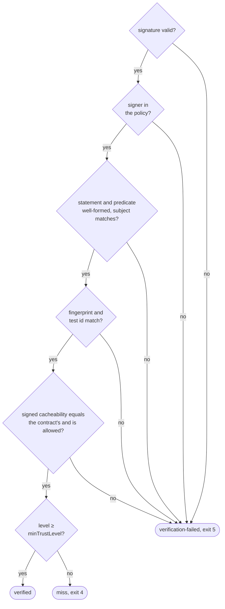

# Trust model

Formats are frozen; see
[artifact format](artifact-format.md#versioning-and-compatibility).

## What a signature proves

An attestation is a DSSE envelope around an in-toto Statement whose predicate
says: "test `test.id`, with inputs hashing to `execution.fingerprint`,
produced `result` on `subject`".

| Proves | Does not prove |
|---|---|
| who signed: an OIDC issuer and subject (keyless), or a key | that the test ran |
| that nobody changed the claim since | that it ran honestly (unmodified test code, no skipped cases, no patched runner) |
| | that inputs not declared in `aval.yaml` were the same |

Reuse needs all three: a valid signature, a signer the policy trusts at a high
enough level, and a fingerprint and test id that match what Aval computed
locally. The predicate's `runner` block is only a claim: identity comes from
the verified signer, level from the policy. A key signer matches only
`publicKey` entries, a keyless signer only `issuer` + `subjectRegexp`
entries.

## Signing

| Mode | Where | Signs with | Rekor | Usual level |
|---|---|---|---|---|
| keyless | CI | an ephemeral key and a short-lived Fulcio certificate for the OIDC token in `$SIGSTORE_ID_TOKEN` | always (the certificate expires in minutes; Rekor's timestamp keeps it verifiable) | runner |
| key | local | an unencrypted ECDSA P-256 PEM key (PKCS#8 or SEC1); Cosign keys are encrypted and not supported | no | developer |

Make a key with
`openssl ecparam -name prime256v1 -genkey -noout -out aval.key`. Getting the
OIDC token is the caller's job, so no CI vendor or issuer is assumed.

Signing always uses the Sigstore public-good instance
(`https://fulcio.sigstore.dev`, `https://rekor.sigstore.dev`)
(TODO(milestone-5): signing against a private Sigstore deployment;
verification already accepts its pinned `trustedRoot`).

## Trust levels

Higher is stronger:

<!-- --8<-- [start:trust-levels] -->

| Level | Name | Constant | Who | Good for |
|---|---|---|---|---|
| 0 | unknown | `TrustUnknown` | level could not be established | never accepted |
| 1 | developer | `TrustDeveloper` | a developer's local signature | personal acceleration only: skip a test you already ran on your machine. Not full trust. |
| 2 | runner | `TrustRunner` | a CI runner with a verifiable workload identity (e.g. GitHub Actions OIDC) | reuse in CI. CI should require at least this level. |
| 3 | isolated | `TrustIsolated` | an isolated execution with a verifiable attestation of the environment itself | reuse where the runner host is not trusted either |

<!-- --8<-- [end:trust-levels] -->

## Policy

The trust policy decides which signers are accepted and at what level.

### Policy file

<!-- --8<-- [start:policy-file] -->

```yaml
apiVersion: aval.trianalab.io/v1
kind: Policy
minTrustLevel: runner           # developer | runner | isolated
# trustedRoot: sigstore/trusted_root.json  # keyless only; default: Sigstore public-good, fetched with TUF
identities:
  - issuer: https://token.actions.githubusercontent.com
    subjectRegexp: https://github\.com/acme/orders/\.github/workflows/ci\.yaml@refs/heads/main
    trustLevel: runner
  - publicKey: keys/alice.pub   # PEM public key file
    trustLevel: developer
allowedCacheability: [external-dependencies]
```

<!-- --8<-- [end:policy-file] -->

<!-- --8<-- [start:policy-fields] -->

| Field | Meaning |
|---|---|
| `identities` | the signers you accept: each is an OIDC `issuer` plus a `subjectRegexp` matched against the whole certificate subject, or a `publicKey` PEM file. At least one. |
| `trustLevel` | the level an identity gets: `developer`, `runner` or `isolated`. |
| `minTrustLevel` | the lowest level a result needs to be reused. |
| `allowedCacheability` | classes reused besides `hermetic` and `controlled-environment`; only `external-dependencies` has an effect, and `non-deterministic` is rejected. |
| `trustedRoot` | a pinned Sigstore trusted root for keyless signatures; without it, the public-good root is fetched. |

<!-- --8<-- [end:policy-fields] -->

Relative `publicKey` and `trustedRoot` paths are read from the policy file's
directory. A policy with an unknown field, a bad level or identity, or more
than one document is rejected, never half-read
([every policy error](guides/troubleshooting.md#errors-exit-1)).

### Verification order



A result whose only problem is a level below `minTrustLevel`, such as a
developer result under a CI policy, is routine non-reuse: a miss, listed in
`rejected`, never a security event. Go callers of `evidence.Verify` get
`ErrVerification` for a level below the minimum; the CLI treats it as a miss.

Signature checks (sigstore-go, against the bundle stored next to the
envelope):

- **Keyless:** chains to a Fulcio CA in the trusted root, has an embedded SCT
  from a trusted CT log, a Rekor entry, and a trusted timestamp inside the
  certificate's validity.
- **Key:** verifies with one of the policy's public keys; no Rekor entry.
- **Both:** the envelope must be the exact one the bundle signs; no bundle
  means no verification.

Without `--policy` nothing is trusted and nothing is looked up: miss. A policy
or trusted root that cannot load: outcome `error` (exit 1), and the test runs.

### Keyless verification needs the network and a writable HOME

Keyless policies without `trustedRoot` fetch the Sigstore root with TUF
(`tuf-repo-cdn.sigstore.dev`) the first time a candidate carries a
certificate, and cache it in `$HOME/.sigstore`. Offline or with a read-only
HOME, that candidate is `error` (never `verification-failed`) and the test
runs. A miss or a key-based result never fetches it.

To avoid the dependency, pin the trusted root in the policy:

1. Get `trusted_root.json` once, on a machine with network access. After one
   keyless `aval verify` there, sigstore-go has it at
   `$HOME/.sigstore/root/tuf-repo-cdn.sigstore.dev/targets/trusted_root.json`.
2. Commit it next to the policy and set `trustedRoot: trusted_root.json`
   (relative to the policy file).
3. Refresh it when Sigstore rotates keys: a stale root fails to verify new
   certificates (outcome `verification-failed`), so watch for that after a
   Sigstore announcement.

Policies with only `publicKey` identities never fetch anything.

## Fail closed

If Aval cannot prove that a previous execution is equivalent and trusted,
the test runs.

- **Fingerprint errors** (empty scope, a glob that matches nothing, a symlink,
  an unreadable file): nothing to look up; the test runs.
- **Registry errors** (unreachable, auth): outcome `error`, exit 1; the test
  runs.
- **Malformed manifest or moved tag:** verification failure, exit 5.
- **Consume by digest:** the tag `sha256-<fingerprint hex>` is only an index;
  everything after lookup uses `repo@sha256:...`
  ([lookup](artifact-format.md#lookup-and-consumption)).
- **No silent replacement:** pushes only add results. Every candidate is
  verified and the highest trusted level wins. A candidate that fails
  verification is listed in `rejected` and stays visible; one that cannot be
  fetched or checked blocks reuse.
- **Unknown or missing fields** in `aval.yaml`: rejected, exit 2.

`aval run --no-reuse` always runs and never looks anything up. What each
outcome does: [Outcomes](concepts/outcomes.md).

## Safeguards in `aval run`

- `$SIGSTORE_ID_TOKEN` is removed from the environment before
  `runner.command` starts, so the code under test cannot sign as the CI job.
- A `--report` that cannot be written disables reuse: the test runs, and a
  verification failure still exits 5.
- Reasons from attestations are escaped on text output and stderr (`\n`,
  `\x1b`, `\u2028`), so they never start a line of their own; the JSON report
  keeps them as is.
- `--shadow` verifies and runs the test anyway, and exits 1 with
  `aval: FALSE HIT: ...` when a verified result disagrees with the real run.
- `--record` publishes an unsigned run record for every outcome; it never
  affects reuse or the exit code
  ([run records](artifact-format.md#run-records)).

## Miss vs verification failure

| Outcome | Go error |
|---|---|
| `verified` | nil |
| `miss` | wraps `evidence.ErrNotFound` (a level below `minTrustLevel`: CLI only) |
| `verification-failed` | wraps `evidence.ErrVerification`; `*evidence.VerificationError` carries the reason |
| `error` | any other |

A verification failure means someone published a result under this
fingerprint that does not verify. Run the test and surface it: fail the job
or alert. Never fold it into a silent re-run.

## Cacheability classes

The class is part of the contract, so it is part of the fingerprint, and it is
copied into the predicate as `test.cacheability`.

--8<-- "docs/contract.md:cacheability"

A candidate whose signed `test.cacheability` differs from the local
contract's is a verification failure.

## Threats

| Threat | Mitigation |
|---|---|
| Compromised developer key | Policy grants developer identities level 1 at most; CI sets `minTrustLevel` >= 2, so a stolen developer key cannot satisfy CI. It can still poison that developer's own reuse. Prefer keyless (short-lived Fulcio certs, Rekor log) over long-lived keys. |
| Tag swapping (`sha256-<fp>` repointed to another manifest) | Tag is lookup only and must resolve to the fingerprint's deterministic anchor manifest; any other target is `verification-failed`. Candidates are the anchor's referrers, fetched and verified by digest. |
| Replay of a passing result for a different fingerprint or test id | Verification requires the signed fingerprint and test id to equal the ones computed locally. The signed predicate cannot be re-labeled without breaking the signature. Mismatch is `verification-failed`. |
| Undeclared input changed (file outside scope, unlisted env var, network service) | Not detected: the fingerprint only covers declared inputs. Mitigated by contract review, `external-dependencies` not being reusable by default and `non-deterministic` never being reusable, and the false-hit suite. Observed-input tracing is future work. |
| Content behind a declared name changed (repushed image tag, new upstream release, changed remote script) | The scanner reports the mutable references it recognizes in the scope and `runner.command`; for `hermetic` and `controlled-environment` an unaccepted one makes the lookup a `miss` and blocks publishing. Accepting one needs `scope.allowMutable`, which changes the fingerprint and shows in review. References it does not recognize stay a known gap ([Pin your dependencies](pinning.md)). |
| Registry compromise (attacker can write arbitrary manifests and tags) | Cannot forge signatures, so it cannot produce reuse on its own; injected attestations show up as `verification-failed`, or, when another candidate verifies, as a `rejected` entry with an `aval: SECURITY: ...` line on stderr. It can delete attestations (forcing re-runs) or deny service (`error`, re-run). Availability is out of scope. |
| Forged or tampered run records (anyone with push access) | Unsigned statistics, never read by `aval run` or `aval verify`; `aval stats` skips malformed records and caps how many it reads. |
| Dishonest but trusted signer (ran a modified test and signed "passed") | Out of scope for Aval. A signature proves who claims it, not that the test ran honestly. Limit which identities get which level; level 3 (isolated) exists for this. |
