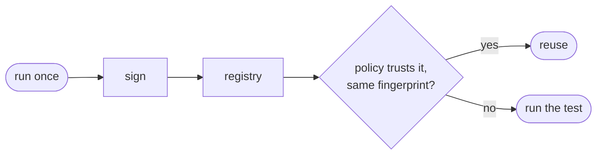

# Vision and roadmap

Why does Aval exist, and where is it going?

## Thesis

- An expensive test runs once and its result is signed and stored in an OCI registry.
- Any other job with the same inputs verifies it and, if the policy allows, skips the test.
- Not a cache: a cache tolerates a stale entry now and then. Aval must justify
  every reuse; when it cannot, the test runs.
- A signature proves *who claims* a pass, not that the inputs match. So reuse
  needs a declared input **contract** (`aval.yaml`) and a **trust policy**.

## Problem

Heavy tests (integration, end-to-end, hardware) rerun on every pipeline even
when nothing they read changed. Teams pay in time, or skip tests on judgment
nobody can audit. Build caches help only teams on a hermetic build system.

## Design decisions

| Decision | Why |
|---|---|
| No own infrastructure: ORAS, Sigstore (sigstore-go), in-toto/DSSE, OCI 1.1 referrers. Lookup by the tag `sha256-<fingerprint hex>`, consumption by digest | registries, signing and access control already exist and are operated; tags are mutable, digests aren't |
| Scope belongs to the test contract (`aval.yaml`); nothing is inferred or traced | the test author knows what the test depends on, and a declared scope can be reviewed in a PR |
| Fail closed: if input equivalence can't be proven, the test runs. A miss (exit 4) and a verification failure (exit 5) stay separate, and the latter is never downgraded | a false hit costs more than a re-run, and a forged result is something someone needs to look at |
| Trust levels (developer, runner, isolated) granted by the policy; no policy, no reuse | how much a signed claim is worth depends on where it was produced, and that call belongs to the consumer |
| Test identity (`metadata.name`) is not the execution fingerprint | the same check gets many executions, and policy and reporting need to tell them apart |
| Cacheability classes; `non-deterministic` is never reusable | a matching fingerprint only means something if the result depends on the declared inputs |
| One generic runner: an argv command, the exit code is the result | it covers every language, framework and CI vendor |

## Non-goals

- No registry, server or database of our own.
- No runtime tracing or input inference in v0; "observed inputs" is future
  work, to check declared scope, not replace it.
- Not a build system or a Bazel replacement.
- Not a test framework: Aval records an exit code, not test cases.
- No knowledge of Pacto or any other consumer; consumers use the
  [stable formats](integrations.md).

## Risks

| Risk | Mitigation | Signal it isn't working |
|---|---|---|
| Bazel or a remote cache is already enough | target tests outside a hermetic build graph (integration, e2e, cross-environment) | early users are mostly Bazel shops that want Aval for build actions |
| Declaring scope costs more than it saves | a small contract (globs, lockfiles, a toolchain map), debuggable with `aval explain` | contracts drift from the code, or teams give up on wide-scope tests |
| Inputs always change, so savings are small | the docs say a "whole repo" scope is a bad fit | a low hit rate in the example and in early adopters' pipelines |
| Security policies reject developer signatures | expected: CI requires runner or higher; developer stays personal | the value does not hold with only runner and isolated signatures |

## Roadmap

| # | Milestone | Status | Done when |
|---|---|---|---|
| 1 | Fingerprint and contract | implemented | `aval.yaml` is validated with unknown fields rejected, and `aval explain` gives a deterministic `aval-fingerprint` digest that fails closed on unprovable inputs |
| 2 | Push and verify against a registry, with signing | implemented | `aval run --push` signs and publishes; `aval verify` and `aval run` reuse a trusted result (exit 0), report a miss (exit 4) and a tampered or untrusted one (exit 5); the policy format is defined |
| 3 | End-to-end example in GitHub Actions | in progress ([CI quality gates](https://github.com/TrianaLab/aval/blob/main/CONTRIBUTING.md#ci-quality-gates)) | a public example where one run publishes, an unchanged run reuses, and a changed run misses, all visible in the logs |
| 4 | False-hit suite | implemented ([false-hit suite](https://github.com/TrianaLab/aval/blob/main/CONTRIBUTING.md#false-hit-suite), [known gaps](contract.md#known-gaps)) | every known kind of relevant change is shown not to reuse a previous execution |
| 5 | Stable consumption contract | in progress | the formats, `pkg/evidence` and the verify report are versioned with only additive changes in v1, and an external consumer verifies with `pkg/evidence` alone |
| 6 | Contract composition for monorepos (Epic 10) | in progress: `scope.contracts` binds other local contracts, transitively ([guide](guides/depend-on-a-contract.md)) | a test in a monorepo reruns when, and only when, the declared inputs of the parts it depends on change |

A remote dependency (another repository, by OCI reference) is an idea, not
built: its files are not available to fingerprint, so it would bind a
published, verified result instead, which raises its own trust questions.
